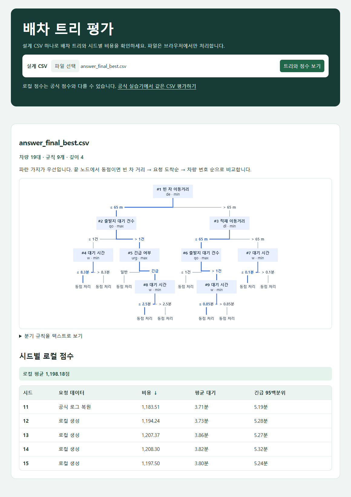

# AMR_Team_14

IE325 물류관리 기말 프로젝트입니다. 고정된 통로망에서 AGV(Automated Guided Vehicle, 무인운반차)의 **차량 대수와 배차 트리**를 정해 시간당 운영 비용을 줄입니다. 배차 트리는 빈 차량과 대기 요청의 조합에 우선순위를 매깁니다.

- [배차 트리 시각화 · 시드별 로컬 평가](https://amr-team-14.github.io/AMR_Team_14/)
- [실험 로드맵](https://amr-team-14.github.io/AMR_Team_14/experiment/) · 원본은 이 브랜치의 `docs/experiment/`이며 수정 후 `gh-pages`의 `docs/experiment/`에 복사해 배포합니다.
- [공식 과제 페이지 · 웹 평가](https://script.google.com/macros/s/AKfycbyfytW6GhEMwkUIE7xja48WGlirBBES_VTXoXxVuzDSHAfcML17mWYwT7VDdBA8gFD9/exec?p=case)

[](https://amr-team-14.github.io/AMR_Team_14/)

## 확정된 과제 규칙

통로 방향과 이동 방식은 케이스에서 고정합니다. 지도의 큰 칸은 **가로 25m, 세로 20m**입니다. 가로 통로에 픽업·하차 지점이 있으면 두 12.5m 구간으로 나뉩니다. 거리는 일방통행 방향을 따라 최단경로로 계산합니다. 빈 차 거리 `de`는 차량의 현재 위치부터 요청 출발지까지, 적재 거리 `dl`은 요청 출발지부터 목적지까지입니다. [케이스 데이터](docs/case.json)

| 항목 | 모델에서 가능한 값 |
| --- | --- |
| 차량 대수 | 정수 **1~30대** |
| `urg` 긴급 여부 | 일반 요청 `0`, 긴급 요청 `1`. `SHIP`행 요청이 긴급이며 CSV 임계값은 `0.5`입니다. |
| `de` 빈 차 거리(m) | `0, 25, 50, 65, 90, 115, 140, 155, 180, 205` |
| `dl` 적재 거리(m) | `25, 50, 65, 90, 115` |
| `qo` 출발지 미배정 건수 | 출발지별 정수 `0~300`. 배차 후보를 평가할 때는 해당 요청을 포함하므로 `1~300`입니다. 차가 배정되는 순간 이 수에서 빠집니다. |
| `w` 배차 전 대기시간(분) | 배차 결정 시각에서 요청 발생 시각을 뺀 값. 시뮬레이션 구간 안에서 이론상 `0~3,000분`의 연속량입니다. |

트리는 **규칙 노드 1~9개**, 루트 번호는 `1`입니다. 같은 변수는 한 경로에서 최대 한 번 쓰므로 깊이는 최대 5입니다. 한 경로에 모든 변수를 넣을 필요는 없고, 서로 다른 가지에서는 같은 변수를 쓸 수 있습니다. 자식 번호 `0`은 추가 비교가 없다는 뜻입니다.

CSV 규칙 행은 `key,id,변수,min|max,임계값,lo,hi`입니다. 공식 웹 기준으로 값이 임계값 **이하(≤)**면 `lo`, **초과(>)**면 `hi`로 갑니다. `min`은 이하 그룹을, `max`는 초과 그룹을 우선합니다. 예를 들어 `key,1,de,min,65,2,3`은 빈 차 거리 65m 이하를 우선하고, 해당 그룹은 2번으로, 초과 그룹은 3번으로 이어집니다. 값이 이산적인 변수에서 같은 두 그룹을 만드는 임계값은 배차 결과도 같습니다.

## 목적함수

시드별 시간당 운영 비용 $C_s$를 낮춥니다. 차량을 추가하면 고정비가 늘고, 배차 규칙에 따라 일반 대기 비용과 긴급 대기 비용이 달라집니다.

$$
C_s = 15n + 0.6 \times 170.4 \times \overline{W}_s + 100 U_{95,s}
$$

| 기호 | 의미 |
| --- | --- |
| $n$ | 차량 대수 |
| $\overline{W}_s$ | 시드 $s$에서 요청 발생부터 픽업까지의 평균 대기시간(분) |
| $U_{95,s}$ | 시드 $s$에서 긴급 요청 픽업 대기시간의 95백분위수(분) |

각 시드는 3,000분 동안 실행합니다. 대기시간 통계에는 300분 이후에 들어와 픽업된 요청을 포함합니다. 미배정 요청이 한때 300건을 넘거나 종료 시 30건을 넘으면 해당 시드는 반려됩니다.

뷰어는 시드 11–15의 비용과 **다섯 비용의 산술평균**을 보여줍니다. 한 시드라도 반려되면 평균을 표시하지 않습니다. 시드 11은 공식 배차 로그에서 요청을 복원하며, 12–15는 로컬에서 생성합니다. 후보를 고를 때는 로컬 평균을 참고하고, 확정 전에는 같은 파일을 공식 과제 페이지에서 평가합니다.

## 팀원별 후보

회의 때 비교할 설계 CSV를 각자 [후보 폴더](solutions/)에 올립니다. 같은 CSV를 공식 과제 페이지에서 **평가 실행**한 뒤, PR에 파일명·차량 대수·로컬 평균·공식 웹 점수를 적습니다.

| | | |
| --- | --- | --- |
| [KMJ](solutions/KMJ/) | [PJH](solutions/PJH/) | [OJT](solutions/OJT/) |
| [YB](solutions/YB/) | [JGD](solutions/JGD/) | [JSM](solutions/JSM/) |

기존 후보 CSV와 [성능 보고서](solutions/KMJ/final_agv_report.md)는 [KMJ 폴더](solutions/KMJ/)에 있습니다. 현재 기준 후보는 main의 19대 트리를 옮긴 [answer_final_best_main.csv](solutions/KMJ/answer_final_best_main.csv)(공식 웹 1,185.42)입니다.

새 후보를 만들 때는 [통합 실험 설계](docs/notes/experiment-design.md)를 따릅니다. 거시 설계(대수·시드·예산·검증)와 미시 설계(트리를 한 층씩 키우는 방법)를 한 문서에 담았고, 개인 계획은 각자 폴더의 `root-plan.md`에 적습니다.

## 하나의 시뮬레이터, 두 가지 사용 방법

웹 화면과 에이전트 실험은 모두 `src/`의 C++ 시뮬레이터로 차량을 배정하고 점수를 계산합니다. 케이스 데이터와 CSV 검증 규칙도 공유합니다.

| 사용 경로 | 하는 일 |
| --- | --- |
| 팀원용 웹 화면 | CSV 하나를 읽어 트리, 시드별 비용·대기시간, 평균 비용을 보여줍니다. WebAssembly로 빌드한 C++ 엔진을 브라우저에서 실행합니다. |
| 에이전트용 명령줄 | 웹 화면 없이 CSV를 채점하고, 차량 대수와 규칙을 탐색하거나 여러 시드에서 비교합니다. 자세한 명령은 [에이전트 실험 가이드](AGENT_EXPERIMENTS.md)에 있습니다. |

```text
src/case_data.*   고정 통로망·최단경로·시드별 요청 준비
src/policy.*      배차 규칙과 CSV 읽기·검증
src/simulator.*   차량 이동·배차·대기열과 비용 계산
src/evaluation.*  시드별 실행과 결과 출력 형식
src/search.*      후보 탐색과 민감도 분석
src/main.cpp      명령줄 진입점
src/web_api.cpp   브라우저가 호출하는 진입점
docs/             팀원용 화면과 웹 배포 파일
```

### 재현용 입력과 신뢰성

[시드별 요청 목록](data/scenarios/)은 동일한 입력으로 후보를 다시 비교할 때 쓰는 스냅샷입니다. 목록이 같아도 차량 배정과 주행은 트리·차량 대수에 따라 달라지므로 후보마다 시뮬레이션을 다시 실행합니다.

[시뮬레이터 검증 기록과 민감도 분석 해석](src/simulator-validation.md)

### 개발과 검증

[기존 구현이 C++를 선택한 이유](docs/notes/cpp-rationale.md)

공개 링크에는 배포 브랜치의 코드가 표시됩니다. 작업 브랜치의 화면은 로컬에서 미리볼 수 있습니다.

- 명령줄 빌드: `node tools/build.mjs native`
- 웹 엔진 재빌드: Emscripten 4.0.21을 활성화한 뒤 `node tools/build.mjs web`. 생성된 `docs/engine/` 파일을 소스 변경과 함께 커밋합니다.
- 로컬 웹 미리보기: `python -m http.server 8080 --directory docs`를 실행하고 [localhost:8080](http://localhost:8080)을 엽니다.
- 두 빌드가 끝나면 `node tests/engine.mjs`로 기존 네 설계의 시드별 점수와 명령줄·브라우저 엔진의 일치를 확인합니다.
- `tools/prepare-viewer-data.mjs`는 공식 케이스와 시드 11 배차 로그에서 필요한 입력을 추출합니다.
