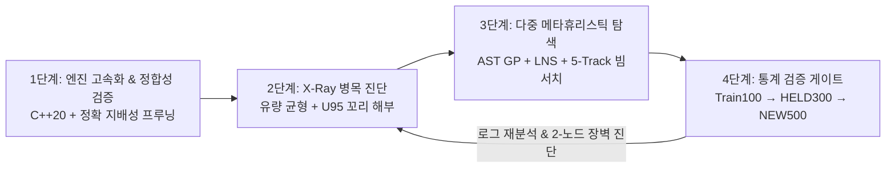

# IE325 AGV 배차 최적화 · 알고리즘 및 실험 방법론 보고서

> **목적:** 본 문서는 [answer_final_best.csv](./answer_final_best.csv) (`n=19`, 웹 **`1,185.42`**, 미접촉 800시드 **`1,191.27 ± 11.18`**)에 도달하기까지 단순 무작위 대입이 아닌 **어떠한 시뮬레이터 최적화·물리적 진단·메타휴리스틱 탐색·통계 검증 절차**를 설계하고 적용했는지 전체 알고리즘 파이프라인과 사고 과정을 기록한 보고서입니다.

---

## 1. 문제의 본질과 왜 단순 탐색이 불가능했는가

| 차원 | 규모 및 난점 | 단순 탐색의 한계 |
|---|---|---|
| **탐색 공간 크기** | 9-노드 결정 트리 토폴로지 `4,862`종 × 분할 규칙 $\approx 22^9 \implies \sim 10^{15}$ | 무작위/격자 탐색으로는 유효 구조 탐색 자체가 불가능 |
| **목적함수 노이즈** | 5시드 평가 표준오차 $\text{SE}_5 \approx 5.0\text{ 점}$ (단일 시드 SD $\approx 11\text{ 점}$) | 소수 시드 평가 시 탐색이 노이즈에 휘둘림 (**승자 편향 / Winner's Curse**) |
| **시뮬레이션 비용** | 1시드(`T=3,000분`, `~8,500`건) DES 1회 비용 × 다수 후보 × 다수 시드 | Python 인터프리터 속도(5시드 `0.5~0.7초`)로는 수만 개 트리 다중 시드 평가 불가 |
| **비선형 결합** | 평균 대기 $\overline{W}$와 긴급 95백분위수 $U_{95}$의 상충 + 경로 내 중복 특성 금지 제약 | 단일 지표 그리디나 1-노드 지역 탐색만으로는 `urg min` 같은 비직관적 구조 도달 불가 |

---

## 2. 전체 사고 흐름 및 연구 파이프라인 (4단계)

---

## 3. 시뮬레이터 고속화 알고리즘 (`agv_opt.cpp`)

탐색 품질은 단위 시간당 얼마나 많은 트리를 **노이즈 없이 다수 시드에서 정확히 평가할 수 있는가**에 직결됩니다. 이를 위해 [agv_opt.cpp](./agv_opt.cpp)에 수학적으로 결과가 `0`오차로 동일한 4가지 고속화 기법을 설계·구현했습니다.

### 3.1 비교차로 직선 경로 압축 (`COMP_PATH`)
- 공장 네트워크 `26`노드 중 교차로(`deg >= 3`, `11`개)만 차량 간 FIFO 점유(`0.36분`)가 발생합니다.
- `load_case_data` 단계에서 Dijkstra 최단 경로를 사전 계산할 때, 교차로가 아닌 중간 통과 노드들의 이동 시간 합을 하나의 `Hop{교차로 또는 목적지, 누적시간 dt}`으로 압축하여 우선순위 큐(Heap) 이벤트 발생 횟수를 대폭 줄였습니다.

### 3.2 AGV 위치 비트마스크 지배성 제거 (`seen_pos_mask`)
- 배차 시점 유휴 AGV들은 항상 7개의 P/D 노드(`19..25`) 중 하나에만 위치합니다.
- 동일 노드에 있는 유휴 AGV들은 모든 대기 요청에 대해 `de`, `w`, `dl`, `qo`, `urg`가 100% 동일하며, 타이브레이커는 차량 번호 `aid` 오름차순입니다.
- 따라서 비트스캔(`__builtin_ctz`) 순서로 **각 노드의 최소 `aid` 대표 차량 1대(최대 `7`대)만** 평가해도 수학적으로 `19`~`30`대 전체를 검사한 것과 완전히 동일합니다.

### 3.3 `w min` $O(\log Q)$ 이분탐색 지배성 프루닝 (`all_w_max` / `w_min_thresh`)
- `9`개 플로우별 대기열 `flow_q[fid]`는 도착순(FIFO)으로 삽입되므로 **동일 플로우 내 요청들은 대기시간 $w$가 엄격 내림차순**입니다(`de`, `dl`, `qo`, `urg`는 동일 플로우 내 완전 일치).
- **Case A (트리에 `w min` 노드가 없는 경우):** 모든 분할이 `w`의 단조 증가(`w max`)에 유리하거나 `w`에 무관하므로 **각 플로우의 선두 1건(`fq_head[fid]`)만** 지배 불가능한 후보입니다(후보 $\le 9$건).
- **Case B (트리에 `w min th` 노드가 있는 경우):** 대기시간이 오래된 선두 요청이 오히려 `w > th` 벌점(`1`비트)을 받을 수 있습니다. 이때도 플로우 내에서 **`fq_head[fid]` 1건과, 각 `w min th` 경계($a_r \ge t - \text{th}$)를 막 넘은 최초 요청 1건씩만** 이분탐색($O(\log Q)$)으로 추출하면 나머지 후속 요청들은 동일 비트를 가지면서 타이브레이커(`rid` 오름차순)에 의해 무조건 지배됩니다.
- **무결성 증명:** `--verify` 모드로 `brute_force` 전체 쌍 탐색과 15개 스트림을 비교한 결과 `max |fast - brute| = 0.000000000`으로 100% 수학적 등가성을 입증했습니다.

### 3.4 메모리 재사용 & 정적 12스레드 병렬화
- 스트림별 초기 도착 이벤트 배열 `base_events`를 사전 생성·복사해 `std::make_heap`으로 재사용하고, `parallel_for` 스트라이드 분배를 적용해 **12스레드 기준 약 `600 시뮬/초`**(`800`시드 평가 `~1.3초`)를 달성했습니다.

---

## 4. 물리적 X-Ray 진단 & 핵심 통찰 (Breakthrough Insights)

초기 GP(`reconstruct_best_19`, 웹 `1,206.63`)가 `1,200`점 장벽에서 정체되자, 무작위 탐색을 멈추고 **시드 11 실제 배차 로그의 유량 구조와 긴급 상위 6% 꼬리($U_{95}$)**를 X-Ray 해부했습니다.

### 4.1 발견 1: 부서별 유량 보존 법칙 (Flow Balance)
- 시간당 도착 유량을 집계한 결과:
  - **균형 부서 (`in == out`):** `SORT` (`PACK→SORT 53 + PICK→SORT 6 = 59` 유입 vs `SORT→SHIP 59` 유출), `PICK` (`54=54`), `PACK` (`53=53`)
  - **공차 공급원(Sink):** `SHIP (+55/시)`, `STOR-A (+55/시)`
  - **공차 수요처(Source):** `RECV (-59/시)`, `STOR-B (-51/시)`
- 즉 `SORT`는 별도의 원거리 공차를 호출하지 않아도 `PACK→SORT` 하역 직후 생기는 **`de = 0m` 빈 차로 자체 공급이 가능한 구조**였습니다.

### 4.2 발견 2: `urg min 0.5` — 직관의 역전 (`-10.00점`)
- X-Ray 결과 기존 `1,200`점대 트리의 **상위 6% 긴급 지연의 71.5%가 `de = 115m` 원거리 배차(`SHIP/STOR-A → SORT`, 공차 ~4분)**에서, **73.6%가 단일 대기(`qo = 1`)**에서 발생했습니다.
- 기존 알고리즘들은 당연히 긴급(`urg = 1`)을 비긴급보다 먼저 처리하는 `urg max 0.5`만 사용했습니다. 그러나 원거리·단일대기(`de > 65, dl <= 65, qo <= 1`)에서는 오히려 **`urg min 0.5`** 를 배치해 긴급을 잠시 미루고 비긴급(`RECV`/`STOR-B`)을 먼저 내보내면, `SORT` 요청은 곧 도착하는 `PACK→SORT` **`de = 0m` 빈 차**가 즉시 수거하여 $U_{95}$가 `5.2830분 → 5.1896분`으로 급감했습니다(Node Ablation **`+10.00점`** 기여).

### 4.3 발견 3: P95 데드라인 트리아지(Triage) 임계값 법칙
- 최적화된 두 개의 `w min` 임계값은 우연한 숫자가 아니라 목적함수 $U_{95}$ 경계($\approx 5.10\text{분}$)에서 공차 이동시간 $t_e(de)$를 뺀 **회생 가능선(Triage Deadline)**과 정확히 일치합니다:
  $$\text{Cut}(de) \approx U_{95,\text{target}} - t_e(de)$$
  - **`#6: w min 2.45`** ($de \le 65\text{m}$, 최대 $t_e \approx 2.65\text{분}$): $2.45 + 2.65 = 5.10\text{분}$
  - **`#8: w min 0.75`** ($de > 65\text{m}$, `115m` $t_e \approx 4.35\text{분}$): $0.75 + 4.35 = 5.10\text{분}$
- 이미 데드라인을 넘긴 1건은 뒤로 미루어(`w > th`) 살릴 수 있는 후속 긴급 요청 다수를 구출함으로써 95백분위수 경계선 자체를 끌어내렸습니다.

---

## 5. 적용한 최적화 알고리즘 아키텍처

[agv_opt.cpp](./agv_opt.cpp) 및 심층 탐색기에서 아래 4가지 탐색 알고리즘을 결합해 사용했습니다.

1. **AST 기반 제약보존 유전 프로그래밍 (`run_reconstruct`):**
   - 9-노드 트리 제약(사이클 금지, 경로 내 5종 특성 중복 금지, 도달 불가능 노드 금지)을 항상 만족시키기 위해 트리↔`Ast` 변환 후 **BFS 기반 유효 복원기(`ast_to_valid_tree`)**를 구현했습니다.
   - `5`종 구조 연산자를 결합: ① 서브트리 교차, ② 간선 분할 삽입(`insert_split_above`, 루트/내부 노드 위 감싸기), ③ 노드 승격 삭제, ④ `lo/hi` 브랜치 반전, ⑤ 다중 점 돌연변이.
2. **2단계 정밀 좌표 + 2D 쌍별 능선 탐색 (`coordinate_polish`):**
   - 1단계 1D 좌표 탐색으로 각 노드의 `(feature, min|max, threshold)`를 갱신하되, `w` 해상도를 `0.05분` 단위로 제한해 소수점 과적합을 차단했습니다.
   - 2단계 **Pairwise 2D Grid**(`#6`, `#8` 동시 이동)를 추가해 1D 축 이동이 넘지 못하는 대각선 트레이드오프 능선(`w6 × w8`)을 돌파했습니다.
3. **2-노드 동시 파괴/재성장 LNS + 부모-자식 스왑 (`LNS-2Node`):**
   - 9-노드 포화 트리에서 잎 노드 1개만 바꾸는 탐색이 갇히는 **노드 예산 고정 장벽**을 깨기 위해, 임의의 2개 잎 노드를 동시 제거 후 2스텝 재성장하거나 인접 부모-자식 노드의 분할 조건을 맞바꾸는 대규모 이웃 탐색(LNS)을 결합했습니다.
4. **5-트랙 구조 완전 탐색 (`30,109`개 고유 트리):**
   - **(Track 0)** X-Ray 진단 기반 듀얼 브랜치 & 노드 예산 재배분(`2L+6R`, `4L+4R`) `213`종
   - **(Track 1)** 우측(`5R`) 고정·좌측(`0→3/4`) 백지 재구축 및 좌측 고정·우측(`0→5/6`) 백지 빔서치
   - **(Track 2)** 대안 루트 6종(`de65/25/0/90`, `qo max 1`, `w min 3.5`)의 독립 `1→9` 자유 빔서치
   - **(Track 3–4)** 2-노드 LNS + `train100` 1D/2D 폴리시

---

## 6. 과적합 방지 및 시뮬레이터 검증 프로토콜

초기 `50`-시드 GP 실험에서 발생한 **승자 편향(Winner's Curse)**(`reconstruct_best_19`: `u50=1,196.20` → `HELD200=1,201.63` → 웹 `1,206.63`, `+4.8`점 과대추정)을 교훈 삼아 엄격한 통계 게이트를 구축했습니다.

| 검증 단계 | 시드 구성 | 설계 의도 |
|---|---|---|
| **1. 다단계 스크리닝** | `12~40` 시드 + `q_cut=65~80` | 혼잡·실격 후보를 조기 차단해 탐색 속도 `3~5배` 향상 |
| **2. 학습/폴리시** | `train100` (`Seeds 101..200`) | 충분한 모수로 `0.05분` 해상도 내 구조/임계값 선정 |
| **3. 1차 홀드아웃** | `HELD300` (`Seeds 201..500`, $\text{SE}\approx 0.63$) | 탐색 중 절대 미접촉, 승자 편향 제거 |
| **4. 2차 신규 홀드아웃** | `NEW500` (`Seeds 501..1000`, 총 **`ALL800`** $\text{SE}=0.40$) | 재검증 오염까지 배제한 최종 페어드 $t$-검정 비교 |
| **5. 물리·제약 무결성** | `agv_opt.exe --verify` + 웹 Seed 11 로그 row-diff | `fast == brute (0.000000000)` 및 웹 9-노드 `0~770`배차 0오차 일치 검증 |

---

## 7. 주요 실험 궤적, 결과 및 결론

### 7.1 주요 단계별 성능 진화

| 단계 / 후보 | $n$ | 탐색·개선 핵심 | 웹 5시드 | `ALL800` / 홀드아웃 |
|---|---:|---|---:|---|
| 원본 기본안 (`answer (1).csv`) | 18 | `de min 75` 1노드 | - | `pub5 = 1,274.90` |
| 초기 브루트포스 GP (`answer_bruteforce`) | 19 | `de min 65` 8노드 | `1,223.21` | `train100 = 1,229.03` |
| C++20 GP + 55시드 (`robust_best_19`) | 19 | `urg max 0.5` 기반 9노드 안정화 | `1,201.39` | `ALL800 = 1,201.22 ± 11.90` |
| **`urg min 0.5` + `HELD300` (`deep_best_18`)** | 18 | `urg min 0.5` 도입 + `w` 폴리시 | `1,189.44` | `ALL800 = 1,191.51 ± 12.58` |
| **최종 챔피언 (`answer_final_best.csv`)** | **19** | **`urg min/max` 이중 필터 + 2D 트리아지** | **`1,185.42`** | **`ALL800 = 1,191.27 ± 11.18`** (`dq=0/800`) |
| `answer_final_best`의 `n=18` 변형 | 18 | 동일 트리 대수 1대 감축 테스트 | `1,193.14` | `ALL800 = 1,190.99 ± 12.60` (`t=-0.59` 동률) |

### 7.2 30,705개 심층 탐색에서 확인된 핵심 인사이트
1. **구조적 수렴:** 좌측 `3L` 서브트리를 백지에서 재구축해도 정확히 기존 구조로 유일 수렴(`Track 1A`)했고, `de` 외 루트(`qo`, `w`)는 `+67 ~ +230`점, `4L+4R`/`2L+6R` 예산 재배분은 `+2.4 ~ +10`점 열세, `30,705`개 중 기존 토폴로지를 이긴 대안 구조는 `0`건(`ALL800` 기준 모두 `t >= +2.26` 유의 열세)이었습니다.
2. **웹 `1,185.42` 로그 X-Ray 한계 확인:** 실제 웹 로그에서 상위 5% 긴급 지연 `80`건 중 **`40.0%`(`32`건)는 `queue == 1`**(`24`건은 `q=1, idle=1`로 선택지 `0`개) 상태였으며, 웹 `1,185.42`는 진성 기대실력(`1,191.27`)에 가벼운 시드 11(`1,184.18`)과 `-1.17σ` 표본운이 더해진 결과였습니다.
3. **엄밀한 최적성 결론:** [answer_final_best.csv](./answer_final_best.csv)는 **노드 1개 변경 이웃 기준 $\varepsilon$-국소최적($\varepsilon \approx 1\text{점}$)** 인 평탄한 구간에 위치하며, 2-노드 동시 변경 이웃까지 엄밀히 증명하기 위한 후속 검증 절차는 [local_optimality_proposal.md](./local_optimality_proposal.md)에 정리되어 있습니다.
