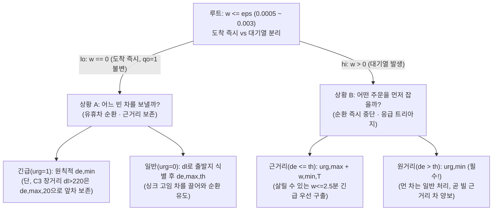

# AGV / OHT 최적화 핵심 인사이트 종합 리포트

이 리포트는 [domain-insights.md](file:///c:/logistic_final_project/.agent/workflows/domain-insights.md)에 축적된 **시뮬레이터 소스 분석 · 자체 진단 프로브(50시드) · 이중 유량 최적화 · 전 팀원(`pjh·yb·jsm·jkd`) 실험 교차 검증** 결과를 한눈에 읽고 바로 의사결정에 활용할 수 있도록 5개 파트로 재구성한 요약본입니다.

---

## 한눈에 보는 핵심 요약 (Executive Summary)

> [!IMPORTANT]
> **점수를 결정짓는 4가지 절대 법칙**
> 1. **교차로 1회 통과 = 무조건 `0.36분(21.6초)` 독점 락:** Case 1은 총비용의 **43.3%(+516pt)**, Case 4는 **38.1%(+304pt)**가 교차로 대기·통과에서 발생합니다.
> 2. **도착 즉시(`w=0`) vs 대기열(`w>0`)은 완전히 다른 세계:** `w == 0`에서는 무조건 `qo == 1`이며, **순환(`de,max`)은 `w == 0`에서만 약이고 `w > 0`에서는 독(`+12.2pt`)**입니다.
> 3. **대기열 원거리 차(`de > th`)에는 긴급을 미뤄라(`urg,min`):** 먼 차가 긴급 주문을 물면 4분 지연이 확정되므로, 일반 주문을 치우고 곧 빌 근거리 차를 기다리는 것이 **-18.7pt** 유리합니다.
> 4. **현재 우리 최고 답안에도 "죽은 노드"가 2~5개씩 숨어 있음:** C2·C5는 실제로 **단 4개 활성 노드만으로** 616.69pt · 782.27pt를 냈으며, 남는 5개 슬롯을 살리면 추가 하락 여지가 큽니다.

---

## Part 1. 시뮬레이터의 물리 법칙과 비용 구조 (게임의 룰)

### 1.1 시간과 속도의 정확한 환산 (`FAC = 1.2`)
가속도 $a_t = 50\text{ m/min}^2$ 때문에 모든 이동·작업 시간에 환산 계수 $\text{FAC} = \frac{60}{50} = \mathbf{1.2}$가 곱해집니다.

| 구분 | 물리 공식 | 실제 소요 시간 |
| :--- | :--- | :--- |
| **공차 주행 ($v_e = 60$)** | $(d / 60) \times 1.2$ | **$0.020 \times d$ 분** (50m당 1분 / 1.2초/m) |
| **실차 주행 ($v_c = 50$)** | $(d / 50) \times 1.2$ | **$0.024 \times d$ 분** (50m당 1.2분 / 1.44초/m) |
| **교차로 통과 (`CRS`)** | $0.3 \times 1.2$ | **무조건 $0.36$분 ($21.6$초)** + 타 차량 대기(`WQ`) |
| **상차 + 하차 (`LD+UL`)** | $(0.5 + 0.5) \times 1.2$ | **배차 1건당 고정 $1.20$분 ($72$초)** |

### 1.2 목적함수와 차량 대수($n$)의 손익 분기점
$$\text{Total Cost} = 15 \cdot n + 0.6 \cdot \lambda \cdot \bar{W} + 100 \cdot U_{95}$$

- **1대 감축 ($-15\text{pt}$):** 차량 부족으로 긴급 95분위($U_{95}$)가 **단 0.15분(9초)**만 늦어져도 이득이 0이 됩니다.
- **1대 증차 ($+15\text{pt}$):** 늘어난 유휴차로 스테이션 앞 차량 보존(Hoarding)에 성공해 $U_{95}$를 **0.3~0.7분**만 깎아도 **순비용 15~55pt가 절감**됩니다.
- **비긴급 희생의 정당성 (`jkd` A/B 검증):** `RECV` 비긴급 P95가 6.84분 $\to$ 8.78분(+7.04pt)으로 늦어지더라도, 전체 긴급 $U_{95}$가 5.83분 $\to$ 5.12분(-70.90pt)으로 줄면 총 63.86pt 이득입니다.

---

## Part 2. 교차로 `0.36t`와 병목의 실체 (50시드 프로브 실측)

차수 $\ge 3$인 노드는 한 번에 1대만 통과하는 상호배제(Mutex) 락이 걸립니다. 교차로 비용을 0으로 끈 반사실 실험(`p=0.36t` vs `p=0.00t`) 결과, **주행보다 교차로가 점수를 지배**하고 있음이 확인되었습니다.

| 케이스 | 실측 비용 | `0.36t` 제거 시 | **교차로 유발 비용** | `CRS+WQ` 시간 비중 | 핵심 병목 교차로 (`WQ` 점유율) |
| :---: | :---: | :---: | :---: | :---: | :--- |
| **Case 1** | 1,191.72 | 675.55 | **+516.17 pt** (43.3%) | **32.98%** (실차주행의 2.1배) | `M50`(34.1%), `M75`(26.9%) — **2곳이 61%** |
| **Case 2** | 625.64 | 531.41 | **+94.23 pt** (15.1%) | **14.37%** | `G2.1`(15.6%), `G3.2`(14.5%), `G2.0`(14.3%) |
| **Case 3** | 981.78 | 757.93 | **+223.85 pt** (22.8%) | **12.40%** | `B2`(30.2%), `T2`(28.4%), `B5`(19.3%) — **3곳이 78%** |
| **Case 4** | 797.81 | 493.70 | **+304.11 pt** (38.1%) | **22.01%** (전체 주행과 동급) | `G5.3`(15.4%), `G4.4`(13.9%), `G4.3`(11.3%) |
| **Case 5** | 780.71 | 580.17 | **+200.54 pt** (25.7%) | **14.03%** | `B0.0`(25.9%), `B2.0`(18.3%), `B2.1`(14.7%) — **브릿지 직후 59%** |

> [!WARNING]
> **시뮬레이터 최단경로의 숨은 맹점 (`score.cjs#L15-L18`)**
> 채점기의 Floyd-Warshall은 `0.36t`(공차 18m·실차 15m 상당) 교차로 비용을 무시하고 순수 거리 `d`로만 경로를 고정합니다(C1에서 2/42 쌍이 0.36분 손해). 또한 동률 거리일 때 `if (d < D[i][j])` 때문에 **항상 노드 인덱스가 작은 교차로로 차량이 쏠리는 편향**이 있습니다.

---

## Part 3. 유휴차 순환("빙빙 돌리기")과 `U_95` 꼬리 방어 메커니즘

### 3.1 긴급 꼬리($\ge U_{95}$)는 왜 터지는가? (`용량 고갈형` vs `공간 편중형`)
- **Case 1 (18대) = 유일한 용량 고갈형:** 꼬리 발생 시 **85.98%**가 진짜 유휴차가 0대인 상태에서 발생합니다 (`SORT` 출발 100%, 유휴차의 **47.1%**가 `SHIP`에 적체).
- **Case 2·3·4·5 = 100% 공간 편중형:** 꼬리 발생 시 **80~98%는 놀고 있는 유휴차가 있음에도** 긴급 목적지 싱크(`S9` 50.9%, `S3` 40.8%, `B-S2·B-S1` 59.9%)에 멀리 고여 있어 터집니다.

### 3.2 이중 체제(Dual-Regime)와 상황별 정반대 규칙

1. **`de,max,th`의 진짜 정체:** 말단 타이브레이커가 항상 `de` 오름차순(`jsim.cjs#L94`)이므로, `de,max,th`는 "가장 먼 차"를 부르는 것이 아니라 **`de <= th`인 근거리 차를 보호(Shield)하고 `th` 직후 가장 가까운 차를 부르는 스위치**입니다. 따라서 `th`는 싱크(`UD`)발 이산 거리(`DIST[UD][o] - eps`)에 맞춰야 합니다.
2. **순환과 대수의 결합 법칙:** 적극적 싱크 순환(`de,max`)은 공차 주행 여유(`n`)를 소비하므로 `STTF`보다 **1~3대 더 큰 함대(C1 21대, C3 22대, C5 23대)**에서 최소점이 형성됩니다. 단, Case 5처럼 브릿지 병목이 강한 맵은 과도한 순환 대신 선별적 `w` 분기가 150pt 이상 우월합니다.
3. **`U_95` 응급 트리아지 (`w,min,T`):** 이미 `2.5분` 이상 늦어 상위 5% 탈락이 확정된(Doomed) 주문은 더 늦어져도 `U_95` 페널티가 0이므로, 아직 구출 가능한 `w <= 2.5분` 긴급 주문을 먼저 처리하는 `w,min`이 이깁니다.

---

## Part 4. 코드 속 숨은 불변식과 트리 설계 비밀

1. **`w == 0 => qo == 1` 100% 수학적 불변식:**
   전 케이스 `377,415`건 시뮬레이션에서 예외 `0`건. 도착 즉시 분기(`lo`)에서는 `qo`와 `w`가 항상 상수(`1`, `0`)이므로 그 아래 `qo`/`w` 노드를 넣으면 100% 죽습니다.
2. **현재 우리 최고 답안 속 "죽은 노드(Zombie Node)" 대거 발견:**
   - **Case 2 (`616.69`):** 9노드 중 **5개가 죽은 노드** $\implies$ 실제 활성 노드 **4개** (5슬롯 미활용)
   - **Case 5 (`782.27`):** 6노드 중 **2개가 죽은 노드** $\implies$ 실제 활성 노드 **4개** (5슬롯 미활용)
   - **Case 4 (`796.68`):** 3슬롯 미활용 / **Case 3 (`982.68`):** 2슬롯 미활용
3. **`(urg, dl)` 흐름 충돌과 `de` 공간 삼각측량:**
   `w == 0`에서는 주문 구별 변수가 `(urg, dl)`뿐인데 C1 `5/9`, C3 `12/25`, C4 `13/22`, C5 `9/19` 흐름이 동일 `(urg, dl)`에 겹칩니다. 이때 싱크 차량 기준 `de`가 다르므로 `de` 분기가 **스테이션/구역(Zone)을 역식별하는 GPS 센서**로 작동합니다.
4. **극단적 빈도 비대칭 (`lo` vs `hi`) & 고유휴율 `urg` 루트:**
   C2(`99.9%`), C5(`99.8%`), C4(`99.7%`), C3(`97.7%`)는 거의 전부가 `lo`(`w == 0`)에서 배차되므로 9노드 중 **5~6개를 `lo`에 배정**해야 합니다. 또한 `imm > 99%` 맵에서 `w` 루트를 쓰면 하위에서 `w` 트리아지를 못 쓰므로 **`urg` 루트와 `w` 루트를 병행 탐색**해야 합니다 (`yb` C2 `GROW-WQ` 604.54pt 실증).

---

## Part 5. 유량 최적화 결론 & 케이스별 맞춤 공략 지도

### 5.1 평균 유량(`F_AVG`) vs 긴급 유량(`F_URG`) 최적화 결론
- **Case 3**처럼 순환이 단순한 루프에서는 **긴급 유량(`F_URG`)이 곧 전역 최적 방향**(`1111111100000000011111011001101`)이며 평균 유량(`W=1.994분`) 대비 **-41.1pt** 유리합니다.
- **Case 4·5**처럼 교차로(32개)·브릿지(`B0.0`) 병목이 있는 맵에서는 `F_AVG` 제약 없이 `UD -> o`만 줄이면 일반 이동거리(`fd`)가 +10~15% 늘어 유휴차가 고갈됩니다. 따라서 반드시 **`F_AVG` 저부하 파레토 영역($\le 1.03 \cdot f_{\text{AVG}}^{\min}$) 내부에서 `F_URG`를 최적화**해야 합니다.

### 5.2 팀 전체 대비 현 위치 및 케이스별 즉시 돌파 포인트

| 케이스 | 우리 현재 최고 (`1~500` / 대수) | `pjh` 최신 (`11~15` / `1~500` / 대수) | 남은 핵심 공략 포인트 |
| :---: | :---: | :---: | :--- |
| **Case 1** | 1,191.80 (18대) | 1,170.20 / 1,184.05 (21대) | `n=20~21`에서 **원거리 대기 `urg,min`** + `SHIP`(115·140·180m) `de,max` 순환 해금 |
| **Case 2** | 616.69 (26대, 활성 4노드) | 613.62 / 616.05 (24대) | 61,536 SCC 24대 + `urg` 루트 트랙 + **죽은 5노드 회수** (`yb` 5노드만으로도 604.54 기록) |
| **Case 3** | 982.68 (21대) | 962.70 / 978.14 (22대) | 54 SCC 1위 방향 고정 + `n=22~23` + **장거리 긴급(`dl>220`) `de,max,20` 보호막** + 2슬롯 보강 |
| **Case 4** | **796.68** (18대, **`1~500` 팀 최고**) | 792.33 / 797.35 (18대) | 교차로 `0.36t` 2배 가중 순환 반전으로 이산 $U_{95}$ 계단 아래 진입 + 3슬롯 회수 |
| **Case 5** | **782.27** (21대, **`1~500` 팀 압도적 1위**) | 770.94 / 786.45 (23대) | **활성 4노드 $\to$ 죽은 5노드 회수** + `n=21~24` `urg` 루트 병행 및 `wenum` 대기 가지 전수 |

### 5.3 분기한정법(Branch & Bound + BestFS) 적용 지침
- **방향(`dir`)·대수(`n`):** 완화 그래프 $G_{\text{relax}}$ 위에서 `SCC=1` 즉시 가지치기 + MCMF·`0.36t` 교차로 하한 기반 $\rho \ge 1$ 컷으로 **엄밀한 BestFS 가능**.
- **배차 트리(`tree`):** 부분 트리의 비단조성 때문에 순진한 B&B 불가 $\implies$ **`w <= eps` 분리 후 Regime-Decoupled BestFS** + **DES 시뮬레이션 내부 $U_{95}$ 5% 초과 조기 중단(Early Fathoming)**으로 가속.
