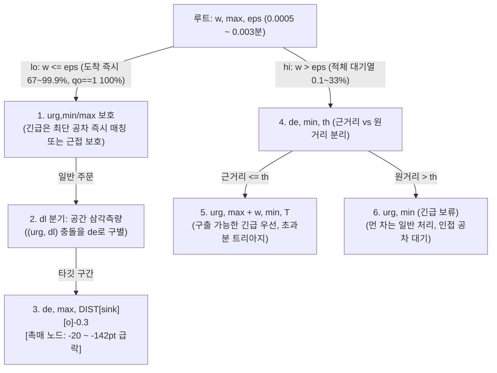

# AGV / OHT 물류 최적화 도메인 인사이트 종합 리포트 (1~17절 완전판)

> [!IMPORTANT]
> 본 리포트는 [domain-insights.md](file:///c:/logistic_final_project/.agent/workflows/domain-insights.md)(1~17절)에 집대성된 **물리 엔진 상수, 수학적 불변식, 배차 트리 촉매 법칙, 교차로 `0.36t` 2분해, $U_{95}$ 꼬리·주차 진공 해부, 스트레스 마진, 팀원 방법론 교차 실증**을 한눈에 볼 수 있도록 구조화한 최종 지식 베이스 보고서입니다.

---

## 1. 한눈에 보는 7대 핵심 물리 법칙

1. **교차로 21.6초 락(`0.36t`):** 차수 $\ge 3$ 교차로는 1대씩만 통과하며 매번 `0.36분`을 점유합니다. **C2·C4·C5는 교차로 비용의 85~86%가 고정 통과 횟수(`nl`)**에서, **C1(41.6%)·C3(31.9%)은 동적 충돌 대기(`Contention`)**에서 발생합니다.
2. **이중 체제(`w <= eps`) & `w == 0 => qo == 1` 불변식:** 도착 즉시(`w == 0`) 배차에서는 항상 `qo == 1`이며, 긴급 우선(`urg,max`) 보호 아래 **실제 일반 주문에만 싱크 공차를 태워 보내는(`de,max`) 편승 순환**만 이득입니다. (유휴차 사전 단독 이동은 전 케이스 `+97 ~ +212pt` 악화)
3. **`de,max` 촉매 법칙(Catalyst Law):** 트리 상위 노드(1~5번)만으로는 `STTF(1n)`과 비용 차이가 `0.0~0.1점`에 불과하며, **리프의 `de,max,th` 1개 노드가 결합되는 순간 `-20 ~ -142pt` 수직 낙하**합니다.
4. **원거리 대기열 긴급 보류(`urg,min`) & `U_95` 트리아지(`w,min`):** 적체 대기열에서 먼 빈 차(`de > th`)가 긴급 주문을 덥석 물면 3.5~4.5분 지연이 확정되므로 일반 주문을 처리하게 두고 인접 차를 기다리는 **`urg,min`**이 전 케이스 보편 우위(`-3 ~ -23pt`)입니다. 또한 이미 `U_95`를 넘긴 극단 지연 긴급 주문은 `w,min,T`로 양보해야 연쇄 붕괴를 막습니다.
5. **주차 진공(Parking Vacuum)이 $U_{95}$ 꼬리를 만든다:** C2·C4·C5의 $U_{95}$ 상위 5% 꼬리는 차가 부족해서(`0-Idle` 1~8%)가 아니라, **긴급 출발지 앞 유휴 주차가 말라붙어(`C5 A-S1` 주차 `0.0%` $\to$ 꼬리의 `52.1%` 유발)** 먼 공차가 우회하기 때문에 발생합니다.
6. **제약 기반 이중 유량(`f_AVG` 제약 하 `f_URG` 최소화):** 교차로 대기를 무시하고 $\sum f \cdot d$만 줄이면 비용이 `+51pt` 폭등합니다(`sum_fd` 역설). 평균 유량 `f_AVG` 상한(`<= 1.05 * min`) 안에서 긴급 싱크 회귀(`f_URG`)를 줄여야 합니다.
7. **공개 시드(`11~15`) vs 일반화(`1~500`) 분리 법칙:** 공개 5시드 맞춤 다듬기는 시드가 바뀌면 역전되는 과적합 위험이 크며, 다중 블록 + `CVaR20` 기반 우리 `v3` 해가 `1~500` 기준 **4342.19점**(전 케이스 100% 수요 `+25%`까지 `DQ = 0` 생존)으로 압도적 일반화 우위를 보입니다.

---

## 2. 시뮬레이터 물리 엔진 & 비용 경제학 (1~2, 4절)

| 물리 상수 / 제약 | 수식 및 정확한 수치 | 최적화 및 설계 시사점 |
| :--- | :--- | :--- |
| **환산 계수 (`FAC`)** | $60 / a_t = 60 / 50 = \mathbf{1.2}$ | 모든 속도·대기·작업 시간에 `1.2` 배수 적용 |
| **주행 속도 (`ve`, `vc`)** | 공차 $\mathbf{0.020 \cdot d}$분 ($60\text{m/min}$), 실차 $\mathbf{0.024 \cdot d}$분 ($50\text{m/min}$) | 실차가 공차보다 20% 느림 |
| **교차로 점유 (`p_occ`)** | $0.3 \times 1.2 = \mathbf{0.36\text{분}}$ (**21.6초**), Mutex 락 | 공차 `18m`, 실차 `15m` 주행과 등가인 병목 핵심 |
| **상하차 고정 시간** | 적재 `0.6분` + 하차 `0.6분` = **1.2분 (72초)** | 1회 주문당 최소 고정 점유 시간 |
| **목적함수** | $15n + 0.6\lambda\bar{W} + 100 \cdot U_{95}$ | **`U_95` 0.15분(9초) = 차량 1대(`15pt`)**; `W`보다 `U_95` 가중치가 압도적 |
| **실격(`DQ`) & 트리 규칙** | `qcap=300`, `endQ<=30`, `SCC=1`, 최대 `9노드`, 경로당 특성 중복 금지 | 루트-리프 경로당 5개 특성(`urg, w, de, dl, qo`) 최대 1회만 사용 가능 |

---

## 3. 배차 트리의 구조적 작동 원리 (3, 6, 10, 11, 16④절)

### ① 핵심 메커니즘 4가지
* **`w == 0 => qo == 1` 불변식:** 시뮬레이터는 매 이벤트 직후 $\min(\text{nIdle}, q_l) = 0$을 유지하므로, `w <= 0.005` 내부(`377,415`건 전수)에서 `qo == 1`이 **100% 성립**합니다. 이곳에 `w`·`qo` 노드를 넣으면 100%:0% **사문화 좀비 노드**가 되어 슬롯만 낭비합니다.
* **`de,max,th`의 진짜 동작:** 가장 먼 차를 고르는 것이 아니라 **`de <= th`인 근거리 공차를 보호(Shield)하고 `de > th` 중 가장 가까운 차를 호출**합니다. 따라서 임계치 `th`는 일반 분위수가 아닌 **싱크발 이산 거리 `DIST[UD][o] - 0.3`**에 맞춰야 합니다.
* **`(urg, dl)` 충돌 & `de` 삼각측량:** `w == 0`에서는 `w=0, qo=1`이라 `(urg, dl)`만 남는데, 다수 노선이 같은 `dl`에 겹칩니다(`C3 12/25`, `C4 13/22`, `C5 9/19`). 이때 싱크 주차 차량과의 `de` 거리 차이가 **출발지/구역을 역식별하는 삼각측량 센서**로 작동합니다.
* **Prefix Ablation (`de,max` 촉매 법칙):** 루트부터 노드 1~5개만 두면 `STTF(1n)`과 비용이 같으나(`0.0~0.1pt` 차이), 리프에 `de,max` 촉매가 붙는 순간 비용이 수직 낙하합니다 (`C1 -44.9pt`, `C2 -141.7pt`, `C4 -20.3pt`, `C5 -59.4pt`).

---

## 4. 미시 물리 해부: 시간 점유 · 교차로 `0.36t` · $U_{95}$ 꼬리 · 주차 진공 (8, 12, 15, 16절)

아래 표는 현 `v3` 최종 해(`ans_c1..c5.csv`) 기준 100~200시드 실측 데이터입니다.

| 케이스 (`n`) | `Idle` / `Empty` / `Load` / `Junc(Occ+Wait)` | `de/dl` 비율 | `0.36t` 대기 vs 고정 비중 | $U_{95}$ 꼬리 주범 (Top 2) | 핵심 병목 교차로 (`Cascade q>=3`) | 최악 주차 진공역 (`Urg%` vs `Park%`) |
| :---: | :---: | :---: | :---: | :--- | :--- | :--- |
| **C1** (`n=21`) | 17.7% / **22.5%** / 13.2% / **30.3%** | **2.04** | **41.6%** vs 58.4% | 긴급밀림 40.4%, 교차로스파이크 **33.8%** | `M50` (**766/seed**, `MaxQ=8`), `M75` (353) | `SORT` (`100%` vs `17.9%`) |
| **C2** (`n=26`) | **54.4%** / 6.2% / 17.6% / 14.4% | 0.42 | 15.1% vs **84.9%** | **원거리우회 55.9%**, 지연 24.8% | `G2.1` (20.2/seed), `G2.0` (16.7) | `S7` (`61.7%` vs `17.8%`) |
| **C3** (`n=22`) | 38.8% / 11.0% / **29.7%** / 11.7% | 0.44 | **31.9%** vs 68.1% | **교차로스파이크 57.4%**, 우회 28.6% | `B2` (**65.9/seed**, `MaxQ=7`), `T2` (52.8) | `S8` (`30.0%` vs **`1.4%`**), `S1` (`30.2%` vs `5.0%`) |
| **C4** (`n=18`) | 48.7% / **5.3%** / 16.2% / **22.0%** | 0.39 | 13.7% vs **86.3%** | **원거리우회 61.5%**, 교차로 27.0% | `G5.3` (3.6/seed), `G4.4` (2.0) | `S7` (`31.6%` vs `3.1%`), `S8` (`31.7%` vs `7.0%`) |
| **C5** (`n=22`) | 52.3% / 7.2% / 17.5% / 13.7% | 0.49 | 14.0% vs **86.0%** | **원거리우회 51.2%**, 교차로 **44.7%** | `B0.0` (36.5/seed), `B2.0` (26.7) | **`A-S1` (`20.3%` vs `0.0%` $\to$ 꼬리 52.1%)** |

> [!TIP]
> **사전 재배치(Proactive Relocation)의 역설:** 유휴차가 놀고 있을 때(`nIdle >= 3 & ql == 0`) 위 진공역으로 빈 차를 미리 이동시키면 오히려 전 케이스 **`+97.2 ~ +212.5pt` 폭등**합니다. 미리 이동하는 동안 차량이 주행 중(`DRV`)이 되어 즉시 배차(`Imm%`)가 무너지고 `0.36t` 통행량만 2배가 되기 때문입니다.

---

## 5. 유량 흐름(Flow) 최적화 · 스트레스 마진 · 일반화 검증 (5, 9, 12, 14, 17절)

### ① 유량 흐름은 왜 결정적인가? — "트리의 성능 천장을 결정"
배차 트리가 같은 조건이라도 **물류 유량(`dir`)이 어떤 통로와 교차로를 타느냐에 따라 40~70점의 구조적 격차**가 발생합니다. 다만 단일 기준(`min sum_fd` 또는 `min f_AVG`)이 아닌 **이중 상황 유량(Situation A vs B) + 병목 간선(`Hot Edges`) 분산**이 핵심입니다.

| 케이스 | Situation A (평균 유량 `f_AVG` 최소) | Situation B (긴급 유량 `f_URG` 최소) | 제약 파레토 + 매칭 트리 (`v3`) | 유량 흐름 지배 법칙 |
| :---: | :--- | :--- | :--- | :--- |
| **C1** | 고정 방향 | 고정 방향 | `1183.70` (`de/dl=2.04`) | `M50->B50`(125.4/hr), `M75->M50`(100.6/hr)에 전체 대기의 61% 집중 |
| **C2** | `702.12` (`U95=2.12`) | `655.71` (**`U95=1.51`**) | **`616.68`** (`U95=1.25`) | 61,536 SCC 중 긴급 유량이 평균 유량을 **-46.4pt 압도** (`G3.1->G3.0` 53.3/hr) |
| **C3** | `1023.82` (`W=1.99`, `U95=5.78`) | `982.71` (**`U95=5.43`**) | **`974.54`** (Sit. B #1 방향) | 54 SCC 중 **긴급 유량 1등이 전역 최적** (**-41.1pt**); `B2->S8`·`S8->B1` (75.0/hr) |
| **C4** | `797.88` (`W=1.96`, `U95=4.76`) | `856.24` (`W=2.14`, `U95=4.96`) | **`791.55`** (`U95=4.47`) | 순수 긴급 유량은 전체 `fd`(+15%) 증가로 공차 고갈 $\implies$ **`f_AVG` 제약 내 파레토 필수** |
| **C5** | `822.16` (`W=1.80`, `U95=3.95`) | `855.40` (`W=1.76`, `U95=4.31`) | **`775.71`** (`U95=3.50`) | 브릿지(`B1.1->B-S1->B2.1` 49.4/hr) 저부하 파레토 내부에서만 긴급 회귀 단축 유효 |

* **유량 불균형(Net Flow) $\to$ 주차 진공의 근원:** 스테이션별 유입(`in`) 대비 유출(`out`)이 큰 역(예: `C5 A-S1`, `C1 SORT`, `C3 S8/S1`)은 유량 구조상 차량이 하차 후 남지 않아 **주차 진공**이 생기며, 반대로 순유입 싱크(`SHIP`, `S9`, `S3`, `B-S2`)에는 유휴차가 고입니다.
* **`sum_fd` 역설 & 1-통로 국소 최적:** `v3` 최종 해는 C2(13개)·C3(4개)·C4(44개)·C5(5개) 합법 1-통로 반전 중 개선이 **0건**인 완전 국소 최적입니다. 특히 `C3 cid=1`(`d_sumFD = -1840m`, `dCost = +51.3pt`), `C5 cid=13`(`d_sumFD = -1040m`, `dCost = +51.6pt`)처럼 **실차 총 거리를 줄여도 긴급 접근성·순환이 깨지면 비용이 폭등**합니다.
* **동점 최단경로 편중:** Case 4는 실차 유량의 **16.2%**가 동점 최단경로를 가지며, Case 1은 공차 동점 경로 2쌍을 최소 교차로(`Min-Junctions`)로 바꾸면 `-8.84pt` 민감도를 보입니다.

### ② 스트레스 마진, 이봉 절벽 & 팀원 방법론 교차 비교
* **수요 급증 생존력:** `v3` 해는 **5개 전 케이스에서 수요 `+25%`($\alpha \times 1.25$)까지 `DQ = 0/100` 생존**하며, `300~3000분` 구간 정상상태 드리프트도 `0.01~0.03분` 이내로 완벽히 안정적입니다. (단, C2는 `x1.15`에서 `+107.6pt`, C5는 `x1.25`에서 `+116.9pt` 비선형 계단 포화 발생)
* **Case 2 이봉 $U_{95}$ 절벽:** 500시드 중 **5.8%(29개)**에서만 원거리 긴급 비율이 `2.94% -> 5.43%`로 5%를 넘기며 `U_95`가 `1.28분 -> 2.93분(+165pt)`으로 점프해 `Std = 38.26`을 만듭니다.
* **범용성 및 일반화 (`1~500`) 교차 실증:**

| 케이스 | `pjh` 공개 `11~15` | `pjh` **`1~500`** | **우리 `v3` `1~500`** | **우리 `v3` `OOS(3001~3500)`** | 일반화 격차 (`v3 - pjh`) |
| :---: | :---: | :---: | :---: | :---: | :---: |
| **Case 1** | 1170.20 | 1184.05 | **1183.7044** | **1182.2639** | **-0.35pt** |
| **Case 2** | 613.62 | **616.05** | 616.6776 | **619.1799** | +0.63pt *(단 `pjh` 새시드 `619.70`)* |
| **Case 3** | 962.70 | 978.14 | **974.5400** | **975.6254** | **-3.60pt** |
| **Case 4** | 788.95 | 793.45 | **791.5536** | **791.0503** | **-1.90pt** |
| **Case 5** | 770.82 | 786.66 | **775.7102** | **774.5223** | **-10.95pt** |
| **합계** | **4306.29** | **4358.35** | **4342.1858** | **4342.6418** | **우리 `v3` `-16.16pt` 우위** |
