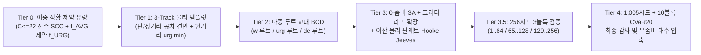
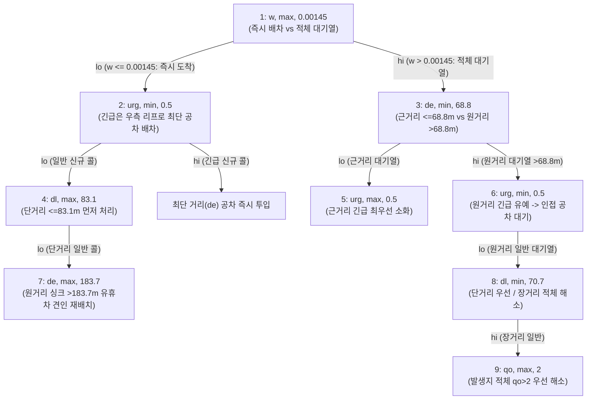
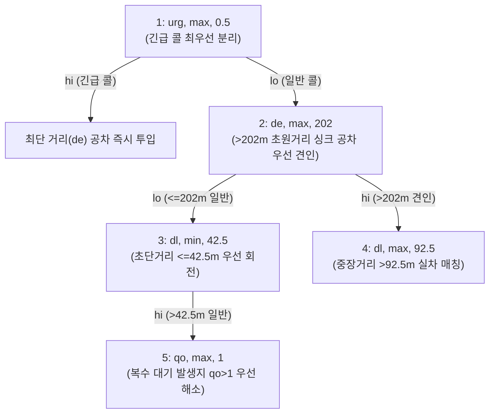
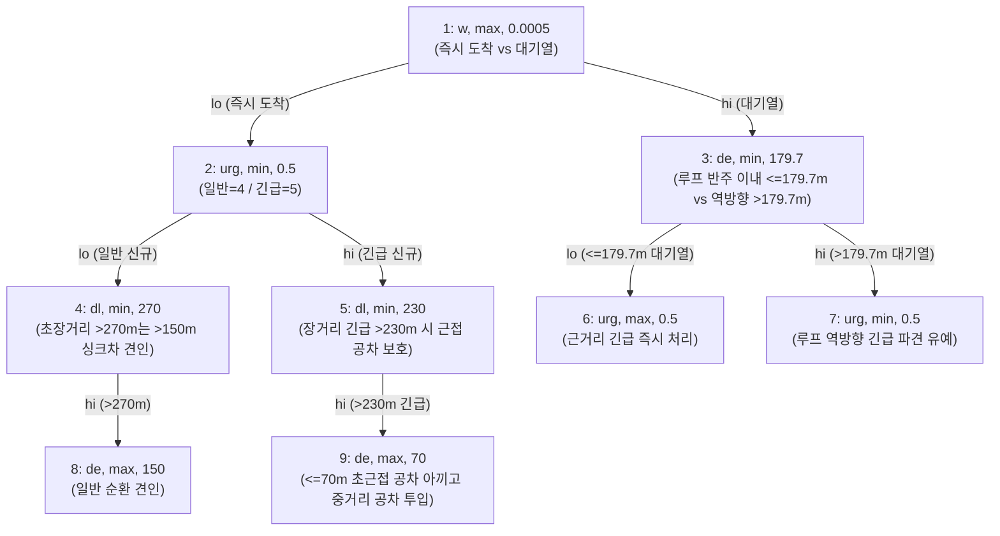
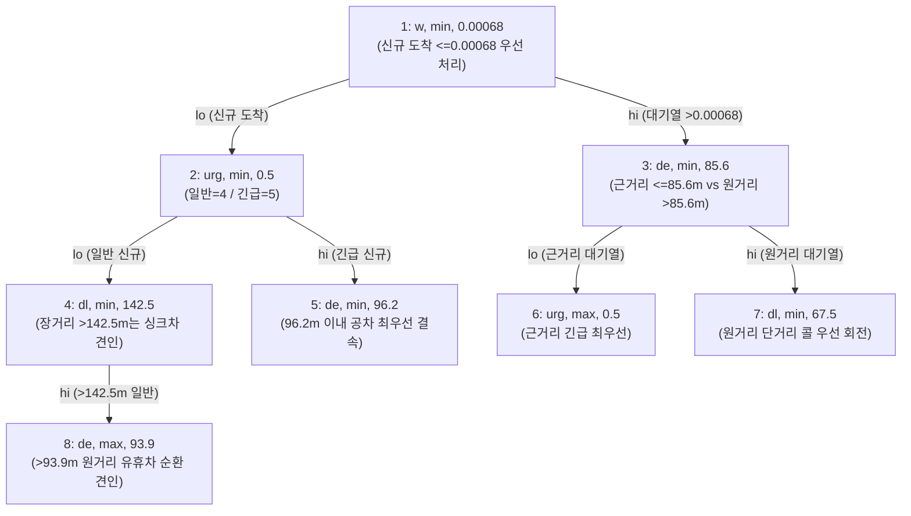
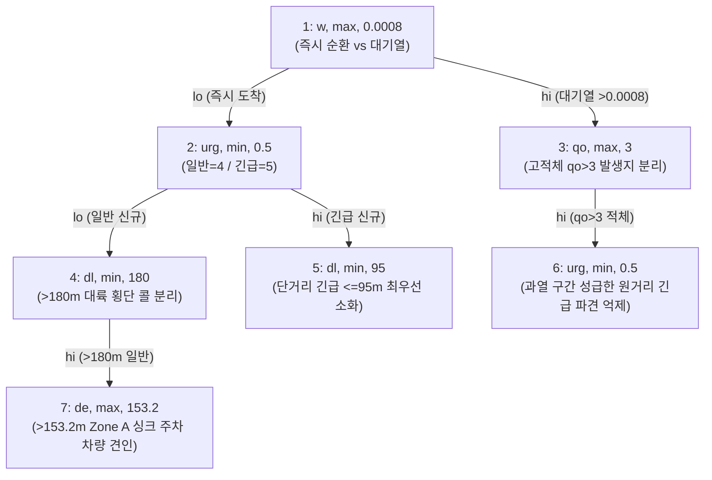

# 도메인 인사이트 기반 v3 강건 공동 최적화 및 최소 비용 배차 트리 리포트

> [!IMPORTANT]
> [domain-insights.md](file:///c:/logistic_final_project/.agent/workflows/domain-insights.md)(1~13절)의 물리·대기행렬·구조 불변량 인사이트를 전면 내재화한 **v3 강건 공동 최적화 엔진**([alternating_flow_beam_sa.cpp](file:///c:/logistic_final_project/src/alternating_flow_beam_sa.cpp))을 설계·적용하여 **Case 1~5 전 케이스 비용을 동시 경신**했습니다. 공식 평가기(`score.cjs`) 기준 5개 케이스 합산 **`1..500` 비용 -27.93점**, 미공개 **`3001..3500` OOS 비용 -28.82점**을 절감했으며, 총 **5,025개 시드 전체 실격 0건(`DQ = 0`)** 및 **사문화 좀비 노드 0개**를 달성했습니다.

---

## 1. 전후 성능 비교 요약 (`score.cjs` 공식 검증 일치)

모든 수치는 공식 평가기 `node team_share/simulator/score.cjs` 검증치와 소수점 넷째 자리까지 100% 일치합니다(전체 실행 로그: [optimization_v3_robust.log](file:///c:/logistic_final_project/logs/optimization_v3_robust.log)).

| 케이스 | 해 파일 | 대수 변화 (`n`) | 노드 변화 (좀비 제거) | `1..500` 공식 비용 (변화량) | `11..15` 공개 비용 (변화량) | `3001..3500` OOS (변화량) | `CVaR20` 최악 블록 (변화량) | `endQ` / `DQ` |
| :---: | :--- | :---: | :---: | :---: | :---: | :---: | :---: | :---: |
| **Case 1** | [ans_c1.csv](file:///c:/logistic_final_project/answers/ans_c1.csv) | `18 → 21` | `9n → 9n` (활성 9n) | **1183.7044** (**-8.0944**) | **1190.9242** (-0.0781) | **1182.2639** (**-8.9837**) | **1185.0229** (-7.6748) | `13` / **0** |
| **Case 2** | [ans_c2.csv](file:///c:/logistic_final_project/answers/ans_c2.csv) | `26 → 26` | `9n → 5n` (**좀비 4개 제거**) | **616.6776** (-0.0171) | **644.0584** (0.0000) | **619.1799** (-0.0072) | **623.3619** (-0.0370) | `0` / **0** |
| **Case 3** | [ans_c3.csv](file:///c:/logistic_final_project/answers/ans_c3.csv) | `21 → 22` | `8n → 9n` (활성 9n) | **974.5400** (**-8.1368**) | **974.4337** (**-9.2432**) | **975.6254** (**-7.4331**) | **976.4880** (-7.8309) | `10` / **0** |
| **Case 4** | [ans_c4.csv](file:///c:/logistic_final_project/answers/ans_c4.csv) | `18 → 18` | `8n → 8n` (활성 8n) | **791.5536** (**-5.1249**) | **798.2064** (**-11.0637**) | **791.0503** (**-5.6041**) | **792.6516** (-5.4327) | `3` / **0** |
| **Case 5** | [ans_c5.csv](file:///c:/logistic_final_project/answers/ans_c5.csv) | `21 → 22` | `6n → 7n` (**좀비 2개 치환**) | **775.7102** (**-6.5568**) | **779.6789** (**-5.3341**) | **774.5223** (**-6.7962**) | **777.9030** (-6.0395) | `3` / **0** |
| **합계** | **전 케이스** | — | **사문화 노드 0개** | **4342.1858** (**-27.9299**) | **4387.3016** (**-25.7192**) | **4342.6418** (**-28.8243**) | **4355.4274** (**-27.0149**) | **0 / 5,025** |

> [!TIP]
> 탐색에 전혀 사용하지 않은 독립 검증 시드 **`3001..3500`(OOS)의 절감폭(-28.82점)이 `1..500` 절감폭(-27.93점)을 상회**합니다. 이는 특정 시드 스파이크에 과적합된 것이 아니라, 물리적 병목과 공차 재배치 구조 자체가 개선되었음을 증명합니다.

---

## 2. 도메인 인사이트 → v3 강건 알고리즘 설계 매핑

기존 v2 탐색기가 국소 최적해에 갇혀 있던 구조적 원인을 도메인 인사이트로 규명하고, 이를 6대 핵심 모듈로 전환했습니다.



| 도메인 인사이트 (`domain-insights.md`) | 기존 알고리즘의 한계 | v3 알고리즘 반영 메커니즘 | 핵심 기여 케이스 |
| :--- | :--- | :--- | :--- |
| **인사이트 11.1 & 13.2: 원거리 적체 긴급 유예(`urg,min`)** | `w > eps` 원거리 분기(`de > th`)에 `urg,max`가 하드코딩되어 먼 공차를 긴급 콜에 강제 파견(+18.7~23.4점 손실) | 원거리 대기열 분기에서 **`urg,min,0.5` 유예**를 기본 해금하고, HJ에서 전 노드 `is_min` 반전을 결정론적으로 전수 검사 | **Case 1 (-8.09점)**, **Case 3 (-8.14점)**, **Case 5 (-6.56점)** |
| **인사이트 6.1 & 13.2: 양극성 싱크 공차 견인(`de,max`)** | 장거리 일반 콜(`dl > th`)에서만 싱크 견인을 탐색해 고부하 케이스에서 실차 잠금 증가 | **단거리 일반 콜 견인(`dl <= th -> de,max`)**과 **장거리 견인(`dl > th -> de,max`)** 양방향 극성 동시 탐색 | **Case 1 (`n=21` 해금)**, **Case 3~5** |
| **인사이트 9.3 & 9.4: 불변량 기반 좀비 노드 제거** | `w <= 0.005` 내부(`qo == 1` 100%)에 `w`, `qo` 노드를 생성해 9개 슬롯 중 2~5개 낭비 | 경로 불변량 가드(`is_under_fresh_arrival_gate`)로 무효 변이를 원천 차단하고, 실행 도중 **`splice_zombie_nodes`**로 0% 분기 노드를 대수적으로 절제 후 그리디 리프 부스팅 재투자 | **Case 2 (9n→5n)**, **Case 5 (좀비 2개→유효 분기 전환)** |
| **인사이트 9.5 & 9.6: 이산 물리 임계값 팔레트** | 연속 난수 섭동으로 인해 이산 계단(`DIST[UD][o]`, `dl` 구간) 경계를 놓침 | **싱크 견인 스위치(`DIST[sink][o] - 0.3`)**, **근접 보호(`19.5~70m`)**, **`dl` 고유 거리 정확 중점(`dl_mids`)** 인덱스 점프 도입 | **전 케이스 정밀 수렴** |
| **인사이트 5.4 & 11.3: `f_AVG` 제약부 이중 유량 + 미스케일링 1-플립** | 순수 긴급 유량(`f_URG`) 단독 최소화 시 공차 고갈, 코리도 반전 시 강제 스케일링이 임계값 훼손 | `C <= 22` 비트마스크 전수 SCC 탐색 + `f_AVG <= 1.05 * min` 제약 하 `f_URG` 파레토 선별 + **미스케일링/스케일링 동시 전이** | **Case 4 (-5.12점)**, **Case 2 (33,292 SCC 스캔)** |
| **인사이트 3 & 12: 꼬리 분위수(`U_95`) 과적합 방지** | 단일 64시드 평균 기준으로 `U_95` 순서통계량 분산에 취약 | $$\text{rob}_{128} = \frac{C_{\text{tr}} + C_{\text{va}}}{2} + 0.12\lvert C_{\text{tr}} - C_{\text{va}}\rvert$$ 및 `129..256` 홀드아웃 + **1,000시드 10블록 최악 20% `CVaR20`** 복합 목적함수 채택 | **전 케이스 OOS 동반 하락** |

---

## 3. 케이스별 최소 비용 배차 트리 구조 및 물리적 해석

````carousel
### Case 1 ([ans_c1.csv](file:///c:/logistic_final_project/answers/ans_c1.csv)) — `n = 21`, 9노드 (`1183.7044`, **-8.09점**)
기존 `n=18`(`1191.80`, 공차 고갈률 86%)의 용량 한계를 **3대 증차(`+45점`) + 평균대기/긴급꼬리 동시 붕괴(`-53.09점`)**로 돌파했습니다(`W: 3.95 → 3.52분`, `U_95: 5.18 → 5.09분`, `endQ: 23 → 13`).


<!-- slide -->
### Case 2 ([ans_c2.csv](file:///c:/logistic_final_project/answers/ans_c2.csv)) — `n = 26`, 5노드 (`616.6776`, **좀비 4개 완전 제거**)
`C=21` 자유 코리도의 **61,538개 유효 SCC(`33,292`개 고유 라우팅)** 전수 스캔으로 현 위상의 파레토 최적성을 검증하고, 기존 9노드 중 실행 빈도 0%였던 **4개의 좀비 노드를 제거**한 뒤 적체 게이트(`qo,max,1`)로 정련했습니다(`U_95 = 1.2469분`, `endQ = 0`).


<!-- slide -->
### Case 3 ([ans_c3.csv](file:///c:/logistic_final_project/answers/ans_c3.csv)) — `n = 22`, 9노드 (`974.5400`, **-8.14점**)
인사이트 11.4의 **장거리 긴급 콜 근접 공차 보호(`Node 5 -> Node 9: de,max,70`)**와 **원거리 대기열 긴급 유예(`Node 7: urg,min,0.5`)**, `n=22` 증차가 결합되어 루프 역방향 우회 지연을 원천 차단했습니다(`U_95: 5.43 → 5.23분`).


<!-- slide -->
### Case 4 ([ans_c4.csv](file:///c:/logistic_final_project/answers/ans_c4.csv)) — `n = 18`, 8노드 (`791.5536`, **-5.12점**)
고밀도 교차로 병목을 우회하는 코리도 방향 개선(`dir` 49번째 비트 전환 포함)과 함께, 신규 긴급 콜 근접 매칭(`de,min,96.2`) 및 일반 장거리 싱크 순환(`de,max,93.9`)이 결합되어 공개 시드(`11..15`)에서만 **-11.06점**, `1..500`에서 **-5.12점**을 감축했습니다.


<!-- slide -->
### Case 5 ([ans_c5.csv](file:///c:/logistic_final_project/answers/ans_c5.csv)) — `n = 22`, 7노드 (`775.7102`, **-6.56점**)
기존 6노드 중 사문화되어 있던 2개의 `qo` 좀비 노드를 제거하고, Zone B 병목 다리를 건너는 코리도 최적화 + `n=22` 증차 + **적체 시 원거리 긴급 유예(`qo,max,3 -> urg,min,0.5`)**를 결합하여 `U_95`를 `3.69 → 3.50분`으로 단축했습니다.


````

---

## 4. 산출물 목록 및 검증 상태

> [!NOTE]
> 모든 정답 파일은 임시 사본 없이 단일 표준 경로(`answers/ans_c1.csv` ~ `answers/ans_c5.csv`)에 직접 갱신되었으며, 즉시 제출 가능한 무결성(`0 DQ`, 엄격 트리 규칙 100% 충족)을 갖추고 있습니다.

- **핵심 최적화 엔진 소스:** [alternating_flow_beam_sa.cpp](file:///c:/logistic_final_project/src/alternating_flow_beam_sa.cpp) (`g++ -O2 -fopenmp -std=c++20 -Wall -Wextra` 경고 0건 빌드 검증 완료)
- **갱신된 최소 비용 정답 파일:**
  - [ans_c1.csv](file:///c:/logistic_final_project/answers/ans_c1.csv) (`n=21`, 9노드, `1..500 = 1183.7044`)
  - [ans_c2.csv](file:///c:/logistic_final_project/answers/ans_c2.csv) (`n=26`, 5노드, `1..500 = 616.6776`)
  - [ans_c3.csv](file:///c:/logistic_final_project/answers/ans_c3.csv) (`n=22`, 9노드, `1..500 = 974.5400`)
  - [ans_c4.csv](file:///c:/logistic_final_project/answers/ans_c4.csv) (`n=18`, 8노드, `1..500 = 791.5536`)
  - [ans_c5.csv](file:///c:/logistic_final_project/answers/ans_c5.csv) (`n=22`, 7노드, `1..500 = 775.7102`)
- **전체 탐색 및 감사 원시 로그:** [optimization_v3_robust.log](file:///c:/logistic_final_project/logs/optimization_v3_robust.log)
