# 상위권 답안 한눈에 보기

케이스별로 **대시보드(공개 시드 11–15, 리더보드 성적)** 상위와 **범용성(시드 1–500 묶음, 반려 0)** 상위를 모았다. 비용이라 낮을수록 좋다.
숫자는 팀 전체 답안을 공통 평가기(`simulator/score.cjs`)로 다시 채점한 값, 트리 그림은 팀 트리 뷰어(`docs/tree-viewer`)로 그린 것이다.
"상위권 전략"은 자동 분석 AI가 `insights/known-insights.md`에 쓰는 해석이다. Case 1은 비공개 시드로 채점하므로 범용성이 기준이다.
README의 최고 기록 표와 같은 데이터에서 만든다. 표 위 순위는 같은 점수를 하나로 묶었다.

## Case 1

### 범용성 상위 (시드 1–500) — Case 1 채점 기준

| 순위 | 점수 | 다른 목표 점수 | 대수 | 통로 | 노드 | 만든 사람 | 출처 |
|---|---|---|---|---|---|---|---|
| 1 | **1180.5642** | 11–15 1185.9410 | 21 | D1 | 9 | 장승민 | jsm: experiments/case1/candidates/8e7431131490.csv |
| 2 | **1180.6962** | 11–15 1177.9655 | 21 | D1 | 9 | 박진홍 | jinhong-experiments: jinhong/answer_jinhong_submitted.csv |
| 3 | **1180.7740** | 11–15 1181.6313 | 21 | D1 | 9 | 박진홍 | jinhong-experiments: jinhong/answer_jinhong_alt.csv |

1위 8e7431131490 트리 (21대, D1) · <a href="trees/case1-8e7431131490.csv">CSV</a>

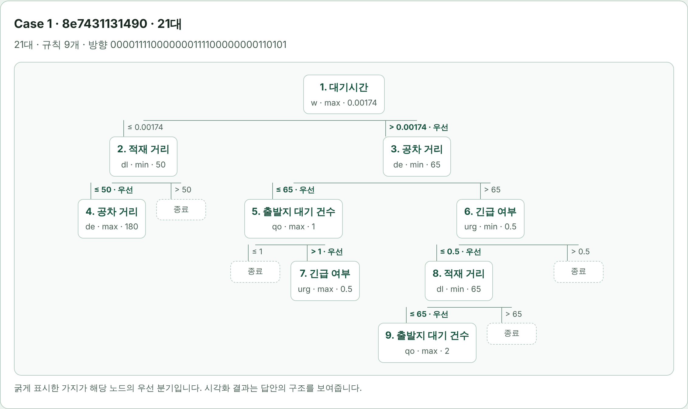

1. w max 0.00174 → ≤:2 / >:3 2. dl min 50 → ≤:4 / >:끝 3. de min 65 → ≤:5 / >:6 4. de max 180 5. qo max 1 → ≤:끝 / >:7 6. urg min 0.5 → ≤:8 / >:끝 7. urg max 0.5 8. dl min 65 → ≤:9 / >:끝 9. qo max 2

2위 da7d865ac362 트리 (21대, D1) · <a href="trees/case1-da7d865ac362.csv">CSV</a>

1. w max 0.00055 → ≤:2 / >:3 2. dl min 50 → ≤:4 / >:끝 3. de min 65 → ≤:5 / >:6 4. de max 180 5. qo max 1 → ≤:끝 / >:7 6. urg min 0.5 → ≤:8 / >:끝 7. urg max 0.5 8. dl min 65 → ≤:9 / >:끝 9. qo max 2

3위 e4e9248a8e06 트리 (21대, D1) · <a href="trees/case1-e4e9248a8e06.csv">CSV</a>

1. w max 0.001 → ≤:2 / >:3 2. dl min 50 → ≤:4 / >:끝 3. de min 65 → ≤:5 / >:6 4. de max 180 5. qo max 1 → ≤:끝 / >:7 6. urg min 0.5 → ≤:8 / >:끝 7. urg max 0.5 8. dl min 65 → ≤:9 / >:끝 9. qo max 2

### 상위권 전략

_자동 분석이 아직 이 케이스의 상위권 전략을 쓰지 않았다._

통로: D1 `000011110000000111100000000110101`

## Case 2

리더보드 1위 기록: **613.16** (박진홍, 진홍 주말 공유 문서 11/28 16:19 제출)

### 대시보드 상위 (공개 11–15)

| 순위 | 점수 | 다른 목표 점수 | 대수 | 통로 | 노드 | 만든 사람 | 출처 |
|---|---|---|---|---|---|---|---|
| 1 | **613.6186** | 1–500 616.0472 | 24 | D1 | 6 | 박진홍 | jinhong-experiments: jinhong/case2/answer_case2.csv |
| 2 | **613.6203** | 1–500 615.9934 | 24 | D1 | 6 | 장승민 | jsm: experiments/case2/candidates/e11ec2f18ec8.csv |
| 3 | **613.6578** | 1–500 616.0930 | 24 | D1 | 9 | 장승민 | jsm 자동 탐색 auto-11272014 |

1위 6f8788c2ef46 트리 (24대, D1) · <a href="trees/case2-6f8788c2ef46.csv">CSV</a>

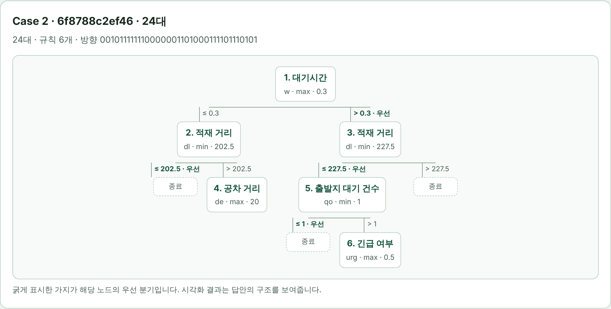

1. w max 0.3 → ≤:2 / >:3 2. dl min 202.5 → ≤:끝 / >:4 3. dl min 227.5 → ≤:5 / >:끝 4. de max 20 5. qo min 1 → ≤:끝 / >:6 6. urg max 0.5

2위 e11ec2f18ec8 트리 (24대, D1) · <a href="trees/case2-e11ec2f18ec8.csv">CSV</a>

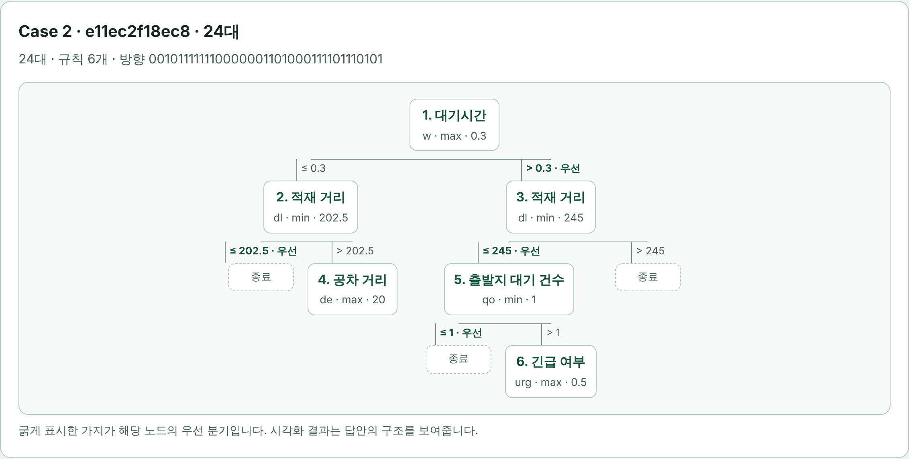

1. w max 0.3 → ≤:2 / >:3 2. dl min 202.5 → ≤:끝 / >:4 3. dl min 245 → ≤:5 / >:끝 4. de max 20 5. qo min 1 → ≤:끝 / >:6 6. urg max 0.5

3위 b8e643459c29 트리 (24대, D1) · <a href="trees/case2-b8e643459c29.csv">CSV</a>

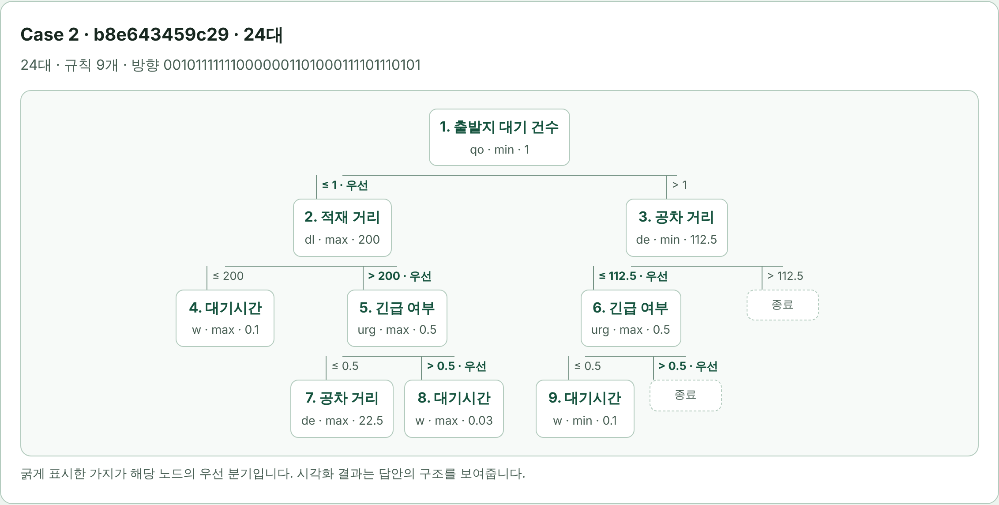

1. qo min 1 → ≤:2 / >:3 2. dl max 200 → ≤:4 / >:5 3. de min 112.5 → ≤:6 / >:끝 4. w max 0.1 5. urg max 0.5 → ≤:7 / >:8 6. urg max 0.5 → ≤:9 / >:끝 7. de max 22.5 8. w max 0.03 9. w min 0.1

### 범용성 상위 (시드 1–500)

| 순위 | 점수 | 다른 목표 점수 | 대수 | 통로 | 노드 | 만든 사람 | 출처 |
|---|---|---|---|---|---|---|---|
| 1 | **603.4758** | 11–15 663.0128 | 24 | D2 | 5 | 장승민 | jsm 자동 탐색 auto-11271811 |
| 2 | **603.6104** | 11–15 663.0128 | 24 | D2 | 5 | 장승민 | jsm 자동 탐색 auto-11272014 |
| 3 | **603.6114** | 11–15 663.0128 | 24 | D2 | 5 | 장승민 | jsm 자동 탐색 auto-11271811 |

1위 e6c5ff027e95 트리 (24대, D2) · <a href="trees/case2-e6c5ff027e95.csv">CSV</a>

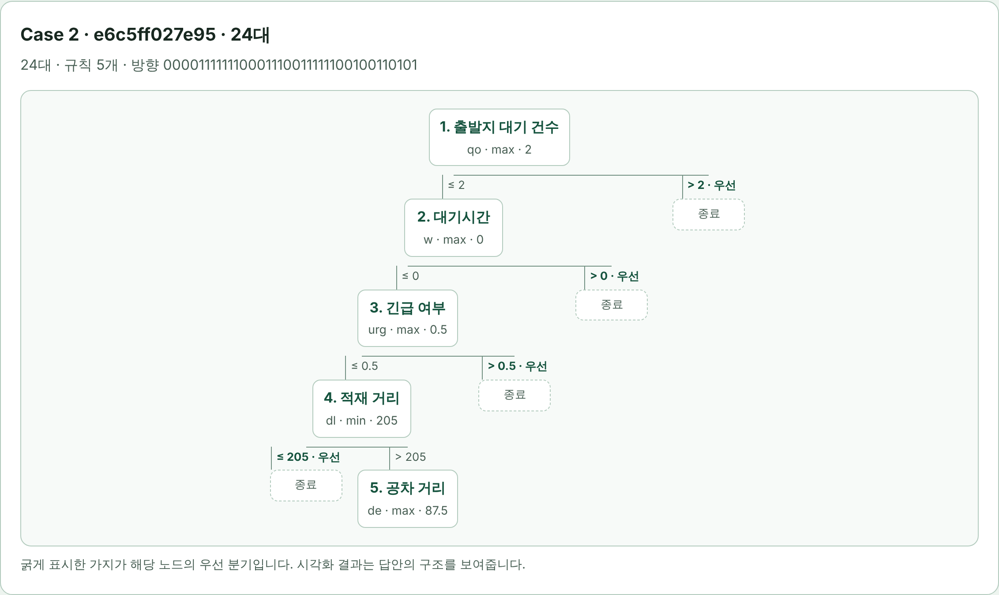

1. qo max 2 → ≤:2 / >:끝 2. w max 0 → ≤:3 / >:끝 3. urg max 0.5 → ≤:4 / >:끝 4. dl min 205 → ≤:끝 / >:5 5. de max 87.5

2위 a08009835ea0 트리 (24대, D2) · <a href="trees/case2-a08009835ea0.csv">CSV</a>

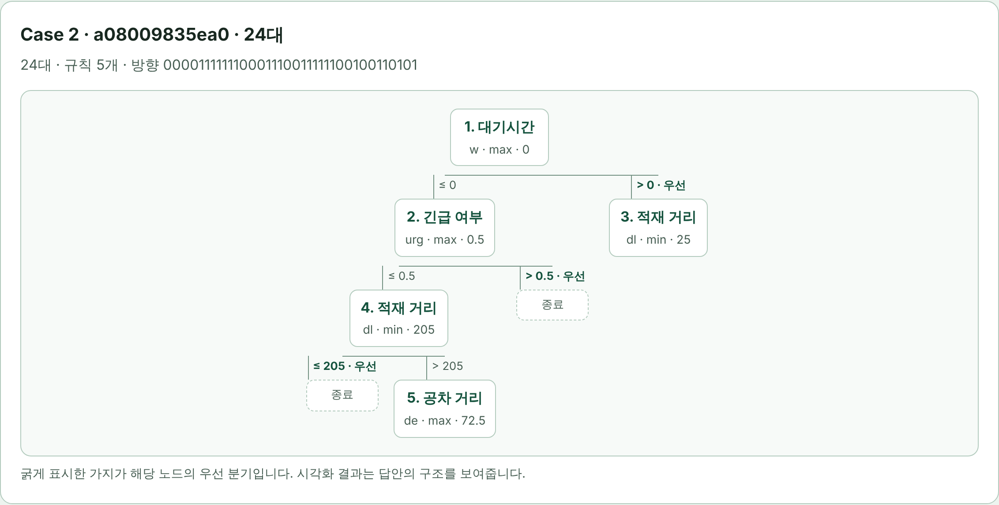

1. w max 0 → ≤:2 / >:3 2. urg max 0.5 → ≤:4 / >:끝 3. dl min 25 4. dl min 205 → ≤:끝 / >:5 5. de max 72.5

3위 c16c605cb304 트리 (24대, D2) · <a href="trees/case2-c16c605cb304.csv">CSV</a>

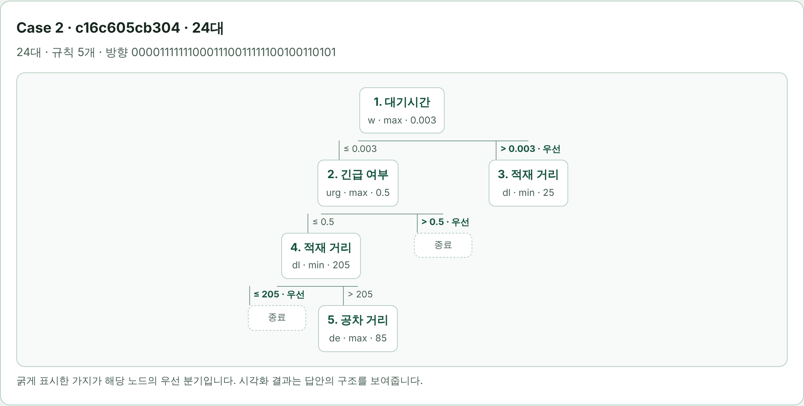

1. w max 0.003 → ≤:2 / >:3 2. urg max 0.5 → ≤:4 / >:끝 3. dl min 25 4. dl min 205 → ≤:끝 / >:5 5. de max 85

### 상위권 전략

_자동 분석이 아직 이 케이스의 상위권 전략을 쓰지 않았다._

통로: D1 `001011111110000001101000111101110101` · D2 `000011111110001110011111100100110101`

## Case 3

리더보드 1위 기록: **962.28** (박진홍, 진홍 주말 공유 문서 11/28 10:59 제출 (jsm 962.45 답에서 출발))

### 대시보드 상위 (공개 11–15)

| 순위 | 점수 | 다른 목표 점수 | 대수 | 통로 | 노드 | 만든 사람 | 출처 |
|---|---|---|---|---|---|---|---|
| 1 | **962.4482** | 1–500 979.5062 | 22 | D1 | 9 | 장승민 | jsm 자동 탐색 auto-11271939 |
| 2 | **962.4482** | 1–500 979.5239 | 22 | D1 | 9 | 장승민 | jsm 자동 탐색 auto-11272134 |
| 3 | **962.4482** | 1–500 979.5243 | 22 | D1 | 9 | 장승민 | jsm 자동 탐색 auto-11272053 |

1위 27d7ec47e34c 트리 (22대, D1) · <a href="trees/case3-27d7ec47e34c.csv">CSV</a>

1. w max 0.03 → ≤:2 / >:3 2. urg max 0.5 → ≤:4 / >:5 3. de min 100 → ≤:6 / >:7 4. dl min 260 → ≤:끝 / >:8 5. dl min 220 → ≤:끝 / >:9 6. urg max 0.5 7. dl max 200 8. de max 140 9. de max 40

2위 0d42595421be 트리 (22대, D1) · <a href="trees/case3-0d42595421be.csv">CSV</a>

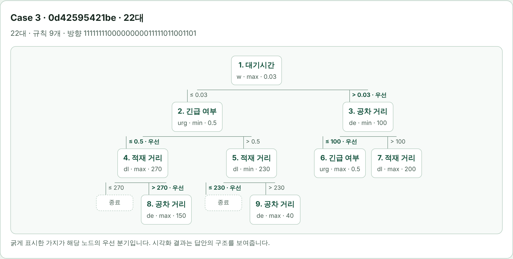

1. w max 0.03 → ≤:2 / >:3 2. urg min 0.5 → ≤:4 / >:5 3. de min 100 → ≤:6 / >:7 4. dl max 270 → ≤:끝 / >:8 5. dl min 230 → ≤:끝 / >:9 6. urg max 0.5 7. dl max 200 8. de max 150 9. de max 40

3위 781522067e21 트리 (22대, D1) · <a href="trees/case3-781522067e21.csv">CSV</a>

1. w max 0.03 → ≤:2 / >:3 2. urg min 0.5 → ≤:4 / >:5 3. de min 100 → ≤:6 / >:7 4. dl min 270 → ≤:끝 / >:8 5. dl min 230 → ≤:끝 / >:9 6. urg max 0.5 7. dl max 200 8. de max 140 9. de max 40

### 범용성 상위 (시드 1–500)

| 순위 | 점수 | 다른 목표 점수 | 대수 | 통로 | 노드 | 만든 사람 | 출처 |
|---|---|---|---|---|---|---|---|
| 1 | **974.5400** | 11–15 974.4337 | 22 | D1 | 9 | 곽민재 | kmj: experiments/case3/KMJ-1127-V3-C3/answer.csv |
| 2 | **974.6897** | 11–15 976.4427 | 22 | D1 | 9 | 장승민 | jsm 자동 탐색 auto-11272053 |
| 3 | **974.7864** | 11–15 976.4710 | 22 | D1 | 9 | 장승민 | jsm 자동 탐색 auto-11271811 |

1위 0f61d990ab1e 트리 (22대, D1) · <a href="trees/case3-0f61d990ab1e.csv">CSV</a>

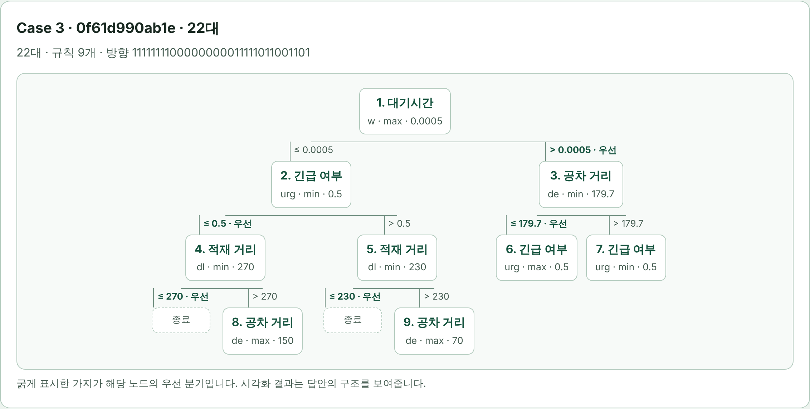

1. w max 0.0005 → ≤:2 / >:3 2. urg min 0.5 → ≤:4 / >:5 3. de min 179.7 → ≤:6 / >:7 4. dl min 270 → ≤:끝 / >:8 5. dl min 230 → ≤:끝 / >:9 6. urg max 0.5 7. urg min 0.5 8. de max 150 9. de max 70

2위 af817b334101 트리 (22대, D1) · <a href="trees/case3-af817b334101.csv">CSV</a>

1. w max 0 → ≤:2 / >:3 2. urg min 0.5 → ≤:4 / >:5 3. de min 140 → ≤:6 / >:7 4. dl min 270 → ≤:끝 / >:8 5. dl min 230 → ≤:끝 / >:9 6. urg max 0.5 7. urg min 0.5 8. de max 150 9. de max 80

3위 cabcd6bc1e65 트리 (22대, D1) · <a href="trees/case3-cabcd6bc1e65.csv">CSV</a>

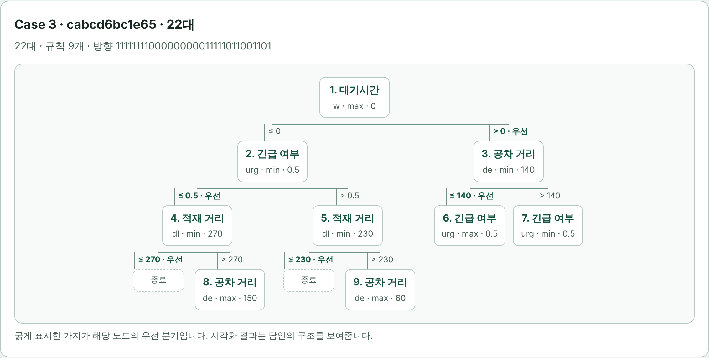

1. w max 0 → ≤:2 / >:3 2. urg min 0.5 → ≤:4 / >:5 3. de min 140 → ≤:6 / >:7 4. dl min 270 → ≤:끝 / >:8 5. dl min 230 → ≤:끝 / >:9 6. urg max 0.5 7. urg min 0.5 8. de max 150 9. de max 60

### 상위권 전략

_자동 분석이 아직 이 케이스의 상위권 전략을 쓰지 않았다._

통로: D1 `1111111100000000011111011001101`

## Case 4

리더보드 1위 기록: **788.95** (박진홍, 진홍 발표 문서 11/26 14:02 (답안 미푸시))

### 대시보드 상위 (공개 11–15)

| 순위 | 점수 | 다른 목표 점수 | 대수 | 통로 | 노드 | 만든 사람 | 출처 |
|---|---|---|---|---|---|---|---|
| 1 | **789.2041** | 1–500 793.3858 | 18 | D1 | 9 | 장승민 | jsm 자동 탐색 auto-11272053 |
| 2 | **789.2102** | 1–500 793.3717 | 18 | D2 | 9 | 장승민 | jsm 자동 탐색 auto-11272053 |
| 3 | **789.2102** | 1–500 793.3902 | 18 | D1 | 9 | 장승민 | jsm 자동 탐색 auto-11281211 |

1위 1e358630afb0 트리 (18대, D1) · <a href="trees/case4-1e358630afb0.csv">CSV</a>

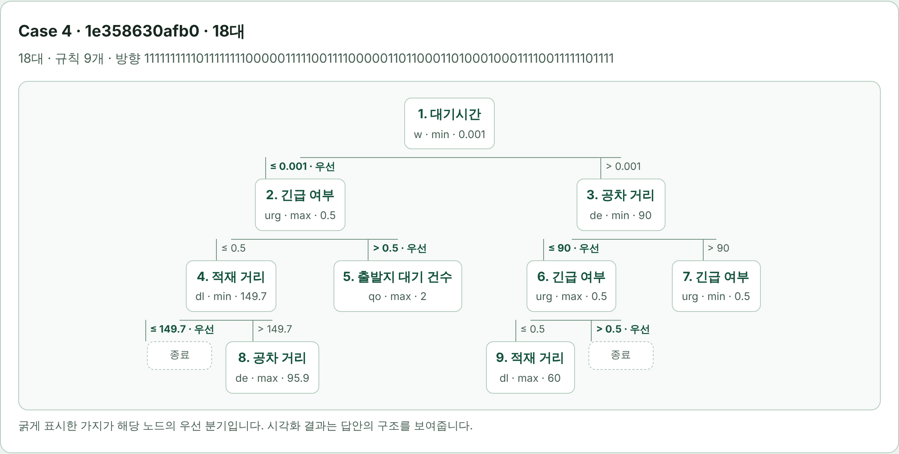

1. w min 0.001 → ≤:2 / >:3 2. urg max 0.5 → ≤:4 / >:5 3. de min 90 → ≤:6 / >:7 4. dl min 149.7 → ≤:끝 / >:8 5. qo max 2 6. urg max 0.5 → ≤:9 / >:끝 7. urg min 0.5 8. de max 95.9 9. dl max 60

2위 60faf3b07318 트리 (18대, D2) · <a href="trees/case4-60faf3b07318.csv">CSV</a>

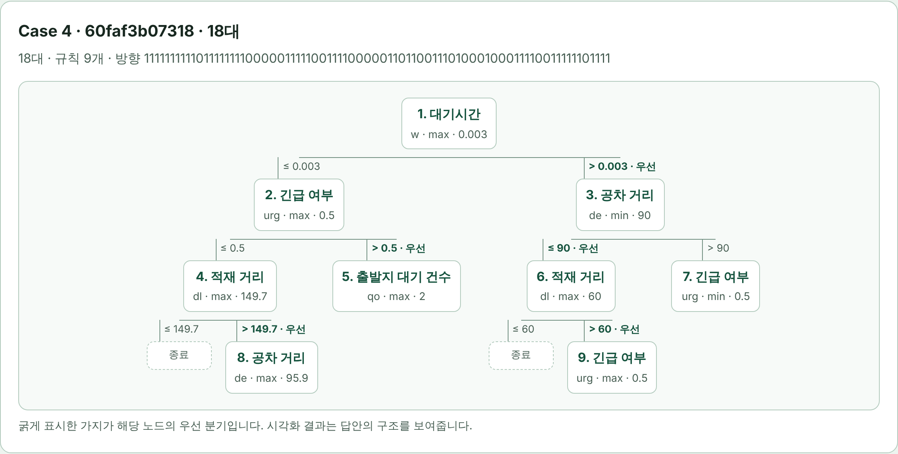

1. w max 0.003 → ≤:2 / >:3 2. urg max 0.5 → ≤:4 / >:5 3. de min 90 → ≤:6 / >:7 4. dl max 149.7 → ≤:끝 / >:8 5. qo max 2 6. dl max 60 → ≤:끝 / >:9 7. urg min 0.5 8. de max 95.9 9. urg max 0.5

3위 bdcffba1caf7 트리 (18대, D1) · <a href="trees/case4-bdcffba1caf7.csv">CSV</a>

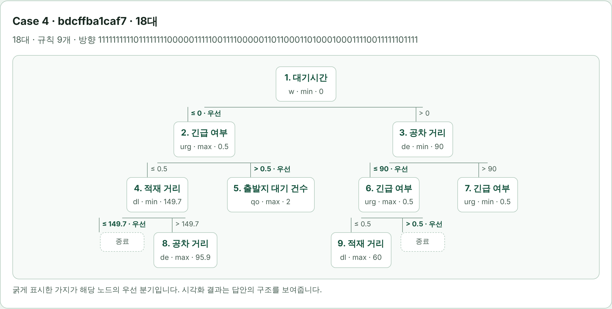

1. w min 0 → ≤:2 / >:3 2. urg max 0.5 → ≤:4 / >:5 3. de min 90 → ≤:6 / >:7 4. dl min 149.7 → ≤:끝 / >:8 5. qo max 2 6. urg max 0.5 → ≤:9 / >:끝 7. urg min 0.5 8. de max 95.9 9. dl max 60

### 범용성 상위 (시드 1–500)

| 순위 | 점수 | 다른 목표 점수 | 대수 | 통로 | 노드 | 만든 사람 | 출처 |
|---|---|---|---|---|---|---|---|
| 1 | **790.4171** | 11–15 793.9583 | 18 | D3 | 9 | 장승민 | jsm 자동 탐색 auto-11272134 |
| 2 | **790.4416** | 11–15 794.7275 | 18 | D4 | 9 | 장승민 | jsm 자동 탐색 auto-11271901 |
| 3 | **790.4512** | 11–15 794.7347 | 18 | D3 | 9 | 장승민 | jsm 자동 탐색 auto-11280330 |

1위 76de42acbc69 트리 (18대, D3) · <a href="trees/case4-76de42acbc69.csv">CSV</a>

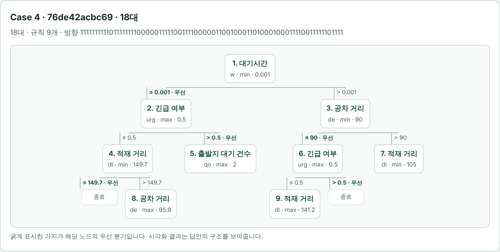

1. w min 0.001 → ≤:2 / >:3 2. urg max 0.5 → ≤:4 / >:5 3. de min 90 → ≤:6 / >:7 4. dl min 149.7 → ≤:끝 / >:8 5. qo max 2 6. urg max 0.5 → ≤:9 / >:끝 7. dl min 105 8. de max 95.9 9. dl max 141.2

2위 00b1d7fe900d 트리 (18대, D4) · <a href="trees/case4-00b1d7fe900d.csv">CSV</a>

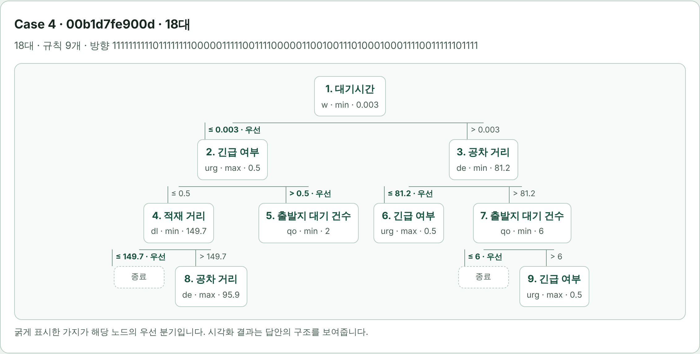

1. w min 0.003 → ≤:2 / >:3 2. urg max 0.5 → ≤:4 / >:5 3. de min 81.2 → ≤:6 / >:7 4. dl min 149.7 → ≤:끝 / >:8 5. qo min 2 6. urg max 0.5 7. qo min 6 → ≤:끝 / >:9 8. de max 95.9 9. urg max 0.5

3위 44a125b86299 트리 (18대, D3) · <a href="trees/case4-44a125b86299.csv">CSV</a>

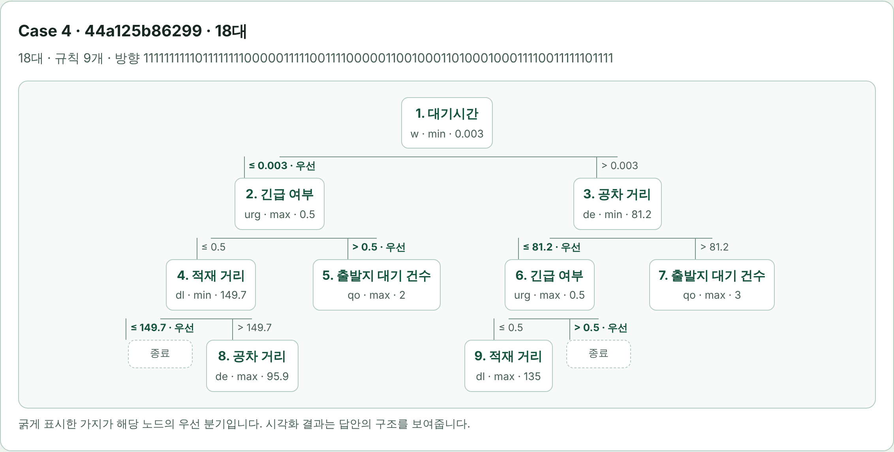

1. w min 0.003 → ≤:2 / >:3 2. urg max 0.5 → ≤:4 / >:5 3. de min 81.2 → ≤:6 / >:7 4. dl min 149.7 → ≤:끝 / >:8 5. qo max 2 6. urg max 0.5 → ≤:9 / >:끝 7. qo max 3 8. de max 95.9 9. dl max 135

### 상위권 전략

_자동 분석이 아직 이 케이스의 상위권 전략을 쓰지 않았다._

통로: D1 `1111111111011111111000001111100111100000110110001101000100011110011111101111` · D2 `1111111111011111111000001111100111100000110110011101000100011110011111101111` · D3 `1111111111011111111000001111100111100000110010001101000100011110011111101111` · D4 `1111111111011111111000001111100111100000110010011101000100011110011111101111`

## Case 5

리더보드 1위 기록: **770.82** (박진홍, 진홍 발표 문서 11/26 14:02 (답안 미푸시))

### 대시보드 상위 (공개 11–15)

| 순위 | 점수 | 다른 목표 점수 | 대수 | 통로 | 노드 | 만든 사람 | 출처 |
|---|---|---|---|---|---|---|---|
| 1 | **770.8816** | 1–500 786.7907 | 23 | D1 | 9 | 박진홍 | jinhong-experiments: jinhong/case5/cand_77088.csv |
| 2 | **770.8819** | 1–500 786.8071 | 23 | D1 | 9 | 장승민 | jsm 자동 탐색 auto-11272134 |
| 3 | **770.8819** | 1–500 786.8488 | 23 | D1 | 9 | 장승민 | jsm 자동 탐색 auto-11271939 |

1위 aed2f894f8a5 트리 (23대, D1) · <a href="trees/case5-aed2f894f8a5.csv">CSV</a>

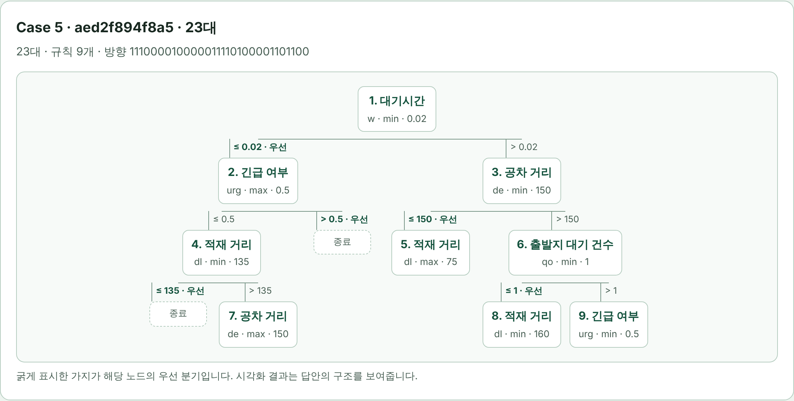

1. w min 0.02 → ≤:2 / >:3 2. urg max 0.5 → ≤:4 / >:끝 3. de min 150 → ≤:5 / >:6 4. dl min 135 → ≤:끝 / >:7 5. dl max 75 6. qo min 1 → ≤:8 / >:9 7. de max 150 8. dl min 160 9. urg min 0.5

2위 c31d57706fcb 트리 (23대, D1) · <a href="trees/case5-c31d57706fcb.csv">CSV</a>

1. w min 0.02 → ≤:2 / >:3 2. urg max 0.5 → ≤:4 / >:끝 3. de min 140 → ≤:5 / >:6 4. dl min 135 → ≤:끝 / >:7 5. dl max 45 6. qo min 1 → ≤:8 / >:9 7. de max 150 8. dl min 225 9. urg min 0.5

3위 ef5d674637bf 트리 (23대, D1) · <a href="trees/case5-ef5d674637bf.csv">CSV</a>

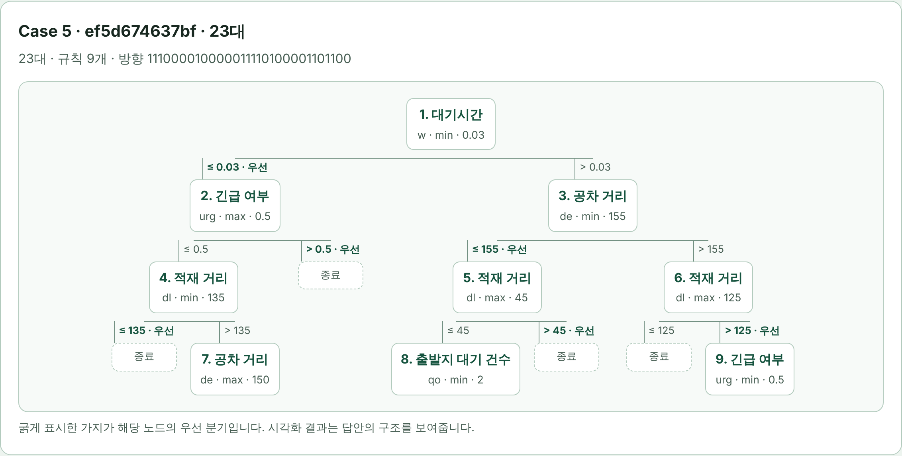

1. w min 0.03 → ≤:2 / >:3 2. urg max 0.5 → ≤:4 / >:끝 3. de min 155 → ≤:5 / >:6 4. dl min 135 → ≤:끝 / >:7 5. dl max 45 → ≤:8 / >:끝 6. dl max 125 → ≤:끝 / >:9 7. de max 150 8. qo min 2 9. urg min 0.5

### 범용성 상위 (시드 1–500)

| 순위 | 점수 | 다른 목표 점수 | 대수 | 통로 | 노드 | 만든 사람 | 출처 |
|---|---|---|---|---|---|---|---|
| 1 | **774.7800** | 11–15 777.9406 | 22 | D2 | 9 | 장승민 | jsm 자동 탐색 auto-11271811 |
| 2 | **774.7987** | 11–15 777.9406 | 22 | D2 | 9 | 장승민 | jsm 자동 탐색 auto-11280859 |
| 3 | **774.8178** | 11–15 778.1986 | 22 | D2 | 9 | 장승민 | jsm 자동 탐색 auto-11280651 |

1위 b9a1e3692503 트리 (22대, D2) · <a href="trees/case5-b9a1e3692503.csv">CSV</a>

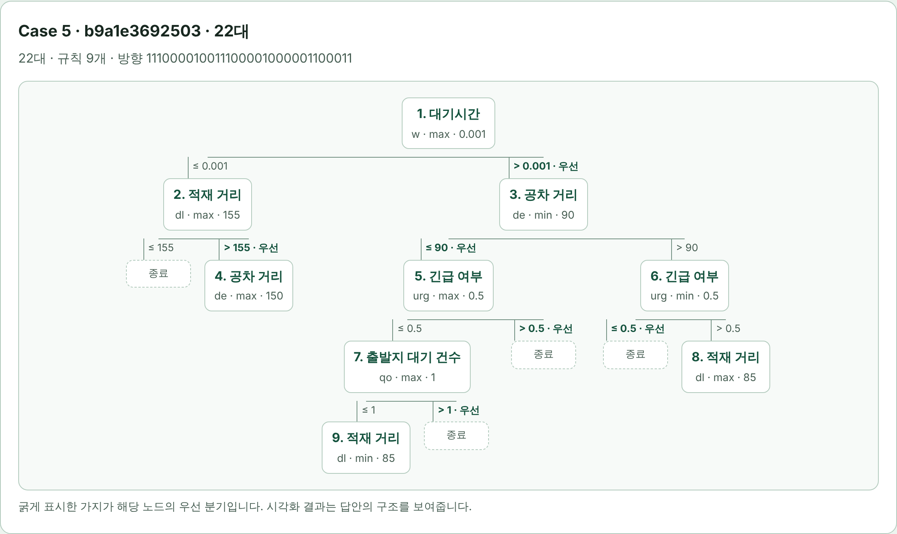

1. w max 0.001 → ≤:2 / >:3 2. dl max 155 → ≤:끝 / >:4 3. de min 90 → ≤:5 / >:6 4. de max 150 5. urg max 0.5 → ≤:7 / >:끝 6. urg min 0.5 → ≤:끝 / >:8 7. qo max 1 → ≤:9 / >:끝 8. dl max 85 9. dl min 85

2위 361c5a1a4a41 트리 (22대, D2) · <a href="trees/case5-361c5a1a4a41.csv">CSV</a>

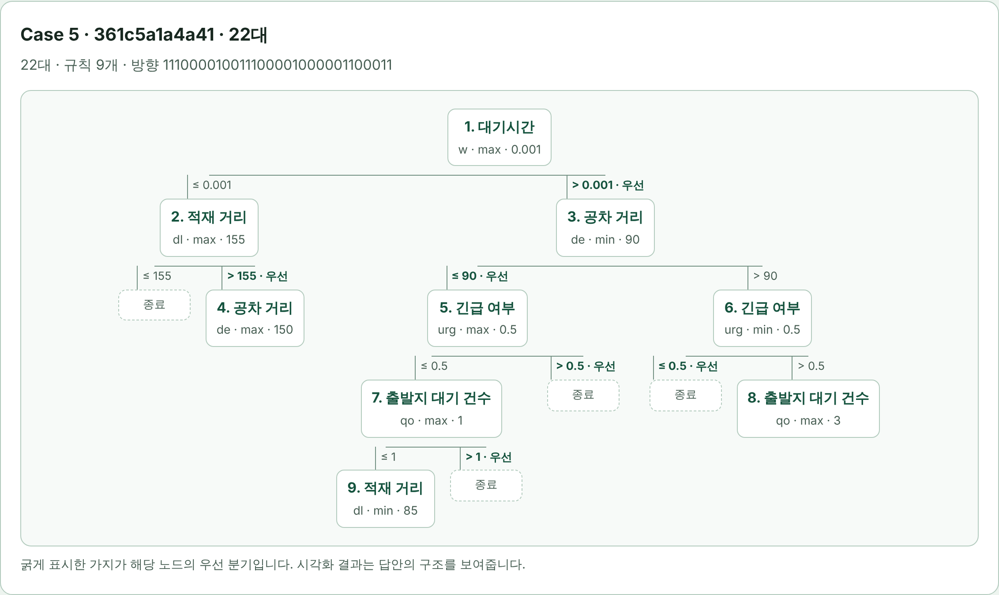

1. w max 0.001 → ≤:2 / >:3 2. dl max 155 → ≤:끝 / >:4 3. de min 90 → ≤:5 / >:6 4. de max 150 5. urg max 0.5 → ≤:7 / >:끝 6. urg min 0.5 → ≤:끝 / >:8 7. qo max 1 → ≤:9 / >:끝 8. qo max 3 9. dl min 85

3위 1cf4fa442041 트리 (22대, D2) · <a href="trees/case5-1cf4fa442041.csv">CSV</a>

1. w max 0.001 → ≤:2 / >:3 2. dl max 155 → ≤:끝 / >:4 3. de min 90 → ≤:5 / >:6 4. de max 150 5. urg max 0.5 → ≤:7 / >:끝 6. urg min 0.5 → ≤:끝 / >:8 7. qo max 1 → ≤:9 / >:끝 8. dl max 205 9. dl min 125

### 상위권 전략

_자동 분석이 아직 이 케이스의 상위권 전략을 쓰지 않았다._

통로: D1 `111000010000011110100001101100` · D2 `111000010011100001000001100011`

